本页说明 BIRD-LSP 1.0.0 的内部结构。[包的依赖关系](./reference/packages.mdx#dependencies)列出了各个包之间的引用关系。文中的函数名和文件名指 BIRD-LSP 仓库 [`packages/@birdcc/`](https://github.com/bird-chinese-community/BIRD-LSP/tree/main/packages/@birdcc) 下的源码，工作流文件名指 [`.github/workflows/`](https://github.com/bird-chinese-community/BIRD-LSP/tree/main/.github/workflows) 下的文件。

## 解析器 [#parser]

`@birdcc/parser` 的 `parseBirdConfig` 把源文本转换成 `ParsedBirdDocument`。它在每个进程中通过 web-tree-sitter 加载一次随仓库提交的语法文件 `tree-sitter-birdcc.wasm`，并缓存解析器。每次调用都把文本解析成 Tree-sitter 语法树，收集解析问题，再把语法树映射为带类型的声明。运行时无法加载时，调用返回一个空程序和一条 `parser/runtime-error` 问题，不抛出异常。

箭头表示调用顺序和数据流向。

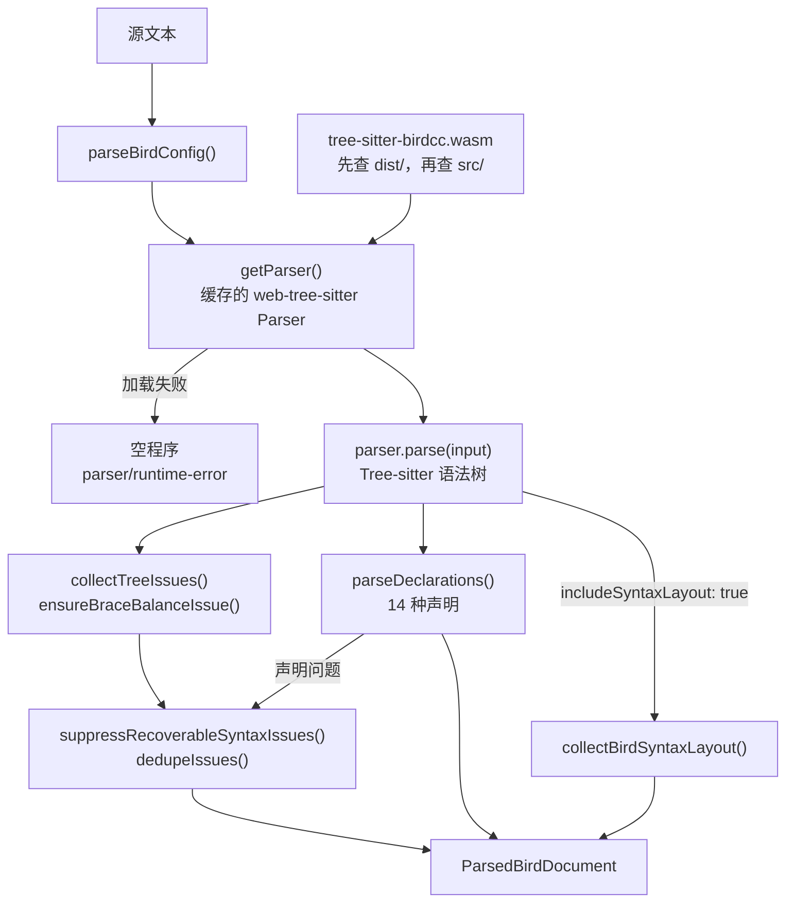

## 语义分析 [#core]

### 快照 [#core-snapshot]

`@birdcc/core` 的 `buildCoreSnapshotFromParsed` 分析一个已解析的文档。它用 `define`、`protocol`、`template`、`filter`、`function` 和 `table` 声明建立符号表。它收集语义诊断（router id、neighbor 地址、前缀字面量）、模板继承环、重复定义和未定义的模板引用。然后它对 filter 和 function 的函数体运行类型检查。`buildCoreSnapshot` 是先解析文本的异步包装函数。

箭头表示调用顺序和数据流向。

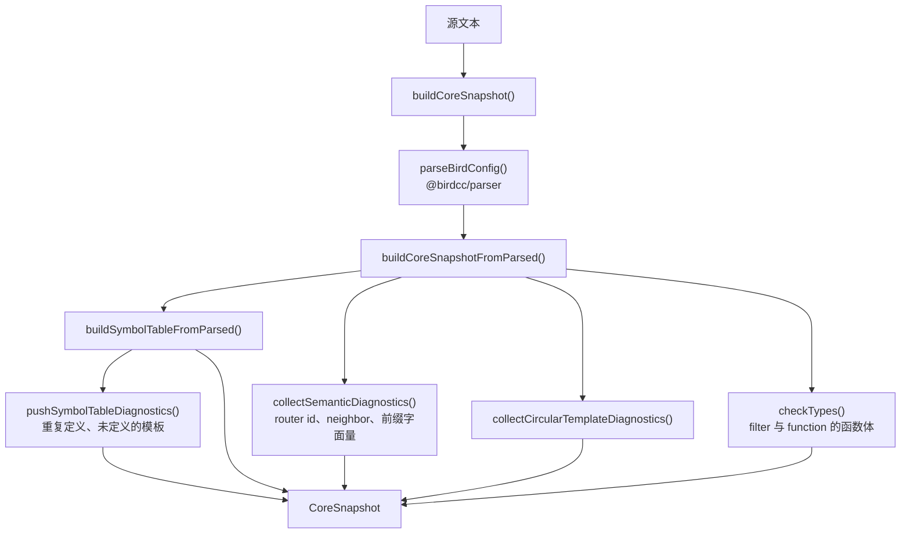

### 跨文件引用解析 [#cross-file-resolution]

`resolveCrossFileReferences` 从入口文件开始，按广度优先顺序跟随 `include` 语句。一个文件在解析之前必须位于工作区根目录内，并且不超过字节上限：每个文件 2 MiB，整个 include 图 16 MiB。默认情况下，队列在 16 层和 256 个文件处停止。已解析的文档来自进程级缓存，缓存最多保存 512 个文档、16 MiB。队列清空后，各文件的符号表合并到一起，因此重复定义和模板引用会跨文件检查。已经访问过或已在队列中的文件会被跳过，include 循环因此结束，不产生诊断。`bird.config.json` 的 [`crossFile` 键](./reference/configuration.mdx#cross-file)可以修改层数、文件数和字节上限。

箭头表示调用顺序和数据流向。虚线箭头是失败路径。

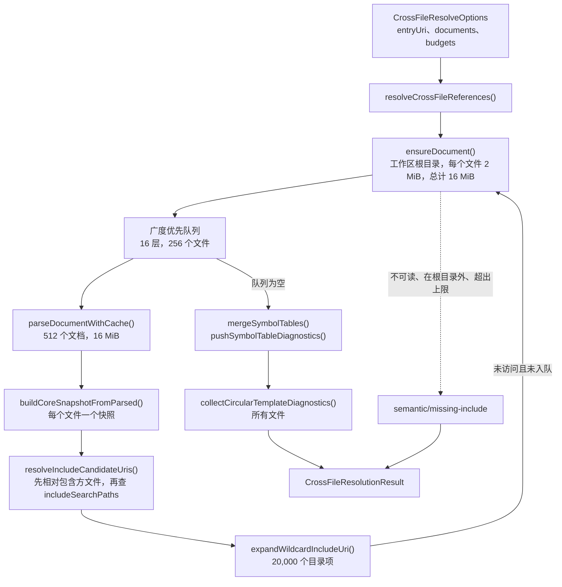

## Linter [#linter]

`@birdcc/linter` 的 `lintBirdConfig` 在调用方传入已解析文档和 core 快照时直接复用它们，否则自行创建。它把解析器和 core 的诊断映射为带默认级别的规则代码，运行六组规则函数，丢弃片段文件或库文件单独无法解析的诊断（见[文件角色](./reference/rules.mdx#file-roles)），并去除重复项。`sym`、`cfg`、`net` 和 `type` 规则的默认级别是 `warning`，`bgp` 和 `ospf` 规则是 `info`。之后，语言服务器用 `@birdcc/core` 的 `applyLintConfiguration` 应用 `bird.config.json` 中的 `linter.rules`，CLI 用它自己的 `applySeverityOverrides` 应用。两者都用 `@birdcc/core` 的 `resolveSeverityOverride` 确定每个代码的级别：完全相同的规则代码优先，其次是匹配的最长 `prefix/*` 键，`off` 删除该诊断（见[修改级别](./reference/rules.mdx#severity)）。

箭头表示调用顺序和数据流向。

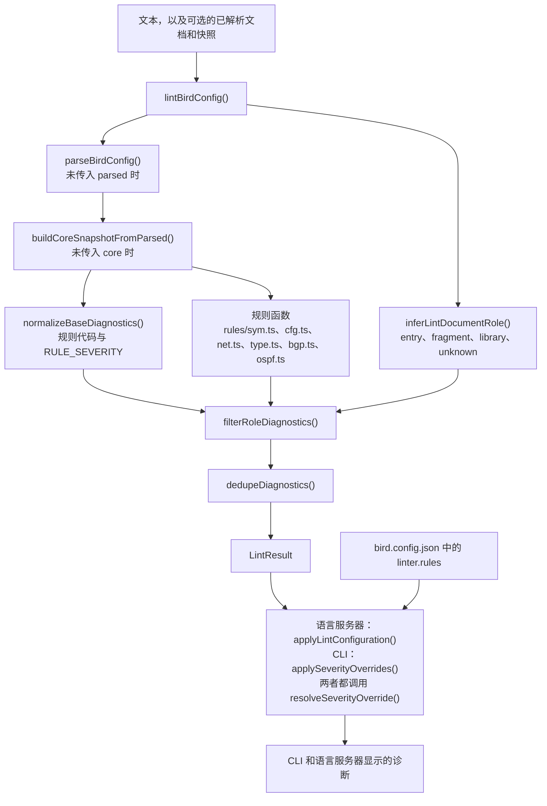

## 格式化器 [#formatter]

### 引擎 [#formatter-engines]

`@birdcc/formatter` 的 `formatBirdConfig` 先补全默认值（`dprint`、缩进 2、行宽 80、空格缩进、开启安全模式），再运行选定的引擎。`dprint` 引擎在 `@dprint/formatter` 上下文中运行 `@birdcc/dprint-plugin-bird` 的 WebAssembly 插件，每组选项缓存一个上下文，最多 16 个。`dprint` 引擎抛出异常且调用方没有传入 `engine` 时，格式化器改用 `builtin` 引擎重新格式化文本。调用方传入了 `engine: "dprint"` 时，错误向上抛出。两个引擎使用相同的按行算法：根据 Tree-sitter 语法树中的括号记号计算缩进，合并连续空行，不折行。[格式化](./formatting.mdx#engines)从使用者的角度介绍这两个引擎。

箭头表示调用顺序和数据流向。

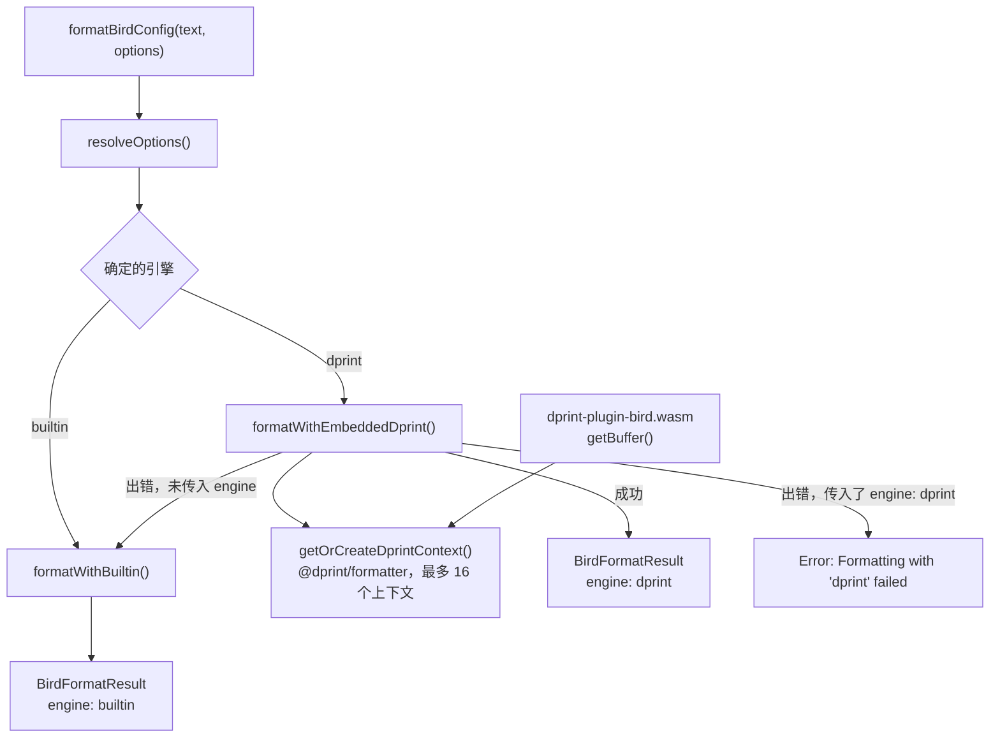

### 安全模式 [#safe-mode]

开启 `safeMode` 时，有改动的输出必须与输入解析出相同的结果。两个引擎都比较由 `@birdcc/parser` 输出构造的语义指纹：去掉源码位置、合并文本中空白的声明树，加上每个解析问题的代码和消息。`dprint` 引擎在 Rust 插件内部还做一次检查，比较 Tree-sitter 节点类型、子节点数量、缺失节点标记和记号文本。含有语法错误的文件，只要解析问题保持不变，也会被格式化。

箭头表示调用顺序和数据流向。

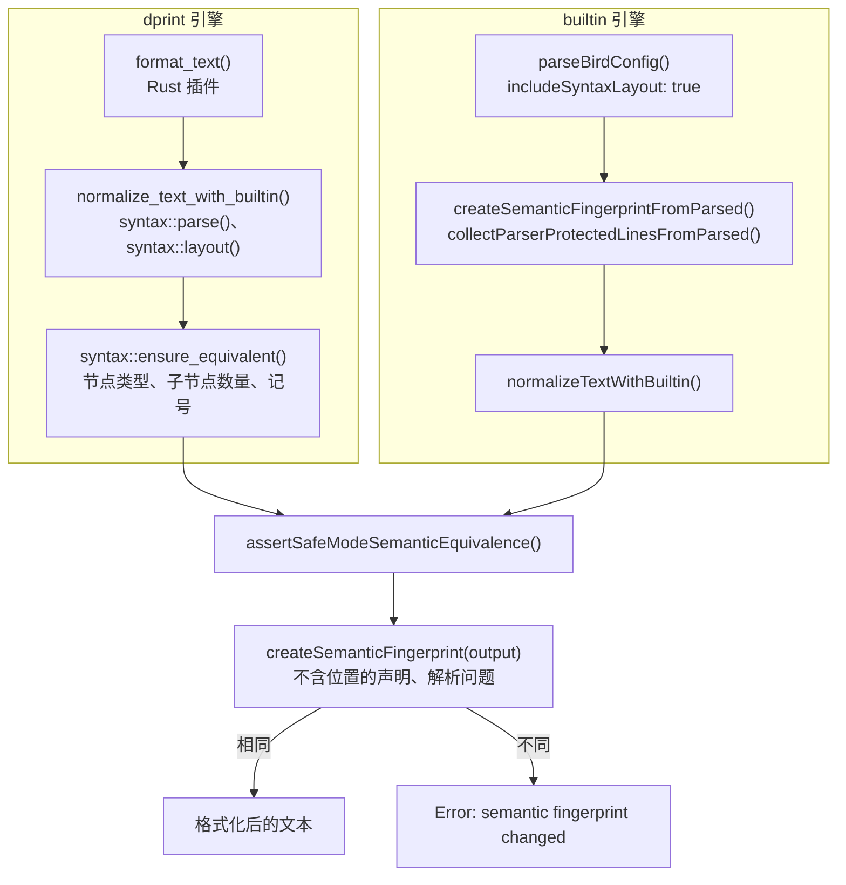

## dprint 插件的构建与分发 [#dprint-plugin]

`@birdcc/dprint-plugin-bird` 的 `build.rs` 用固定版本的 `tree-sitter-cli` 处理 `packages/@birdcc/parser/grammar.js`，把 `parser.c` 写入 Cargo 的 `OUT_DIR`，再用 `cc` crate 编译。因此，WebAssembly 模块内置的语法与 `@birdcc/parser` 相同。`scripts/build-wasm.mjs` 以 `wasm` feature 为 `wasm32-unknown-unknown` 构建这个 crate，并把模块复制到 `dist/dprint-plugin-bird.wasm`。`dist/index.js` 通过 `getPath()` 和 `getBuffer()` 提供这个模块，发布工作流用 Tegami 把包发布到 npm。`@birdcc/formatter` 的默认引擎 `dprint` 把 `getBuffer()` 传给 `@dprint/formatter` 上下文的 `addPlugin()`。dprint CLI 通过文件路径或 `npm:` 说明符加载同一个文件（见[使用 dprint 插件](./formatting.mdx#dprint)）。

箭头沿构建和数据流向，从源文件指向使用方。

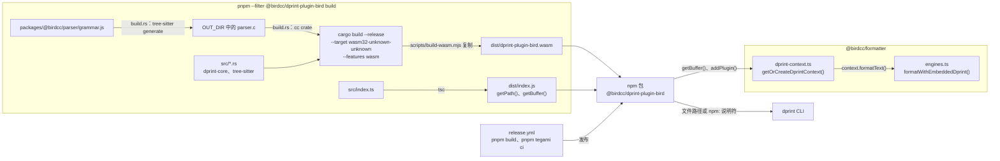

## 语言服务器的诊断流程 [#lsp-diagnostics]

每个打开或修改事件都会使受影响的条目失效，并为每个文档 URI 安排一次校验。调度器在最后一个事件之后等待 120 ms，并丢弃已被更新事件取代的结果。校验先为文档确定项目，检查大小上限和文档准入条件，再从入口文件解析 include 图并检查整个图。服务器在分析过程中发布图中其他文件的诊断，调度器发布文档本身的诊断。`crossFile.enabled` 为 `false` 时，`lintBirdConfig` 单独检查这个文档。语言服务器参考中的[诊断](./reference/language-server.mdx#diagnostics)一节说明发布的结果。

箭头按时间顺序表示消息和调用。

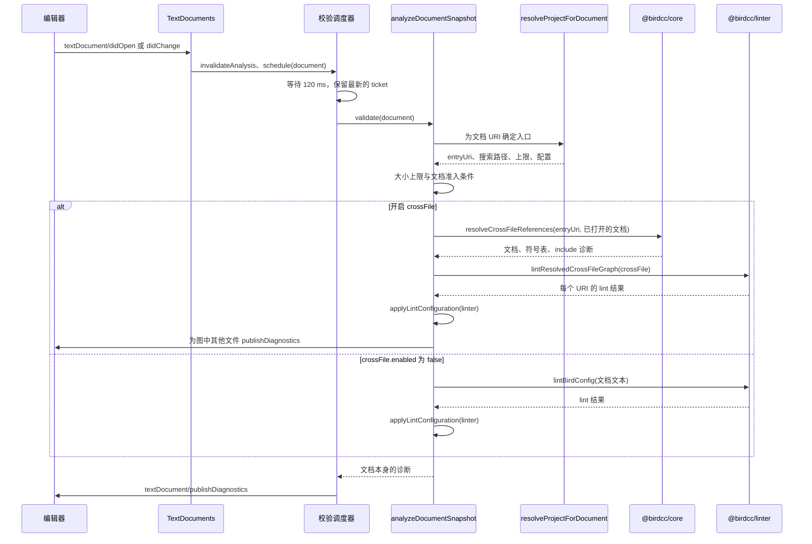

## 项目入口的确定 [#project-entry]

`birdcc` 和语言服务器用同一个加载函数读取最近的 `bird.config.json` 或 `birdcc.config.json`，但选择 include 图入口的方式不同。`birdcc lint` 从文件参数获得检查目标。没有文件参数时，配置设置了 `workspaces` 就使用 `workspaces`，否则使用 `main`。对于不含 `include` 行的目标，它在目标所在目录及最多四层上级目录中探测入口文件。存在配置文件时，语言服务器从 `workspaces` 或 `main` 取得入口；不存在时，它在文档所在的工作区文件夹中探测入口文件。两者都把 `includePaths` 按配置文件所在目录解析后追加到 include 搜索路径。[入口探测](./project-configuration.mdx#entry-detection)和 [include 解析](./project-configuration.mdx#include-resolution)说明具体规则。

箭头表示控制流。

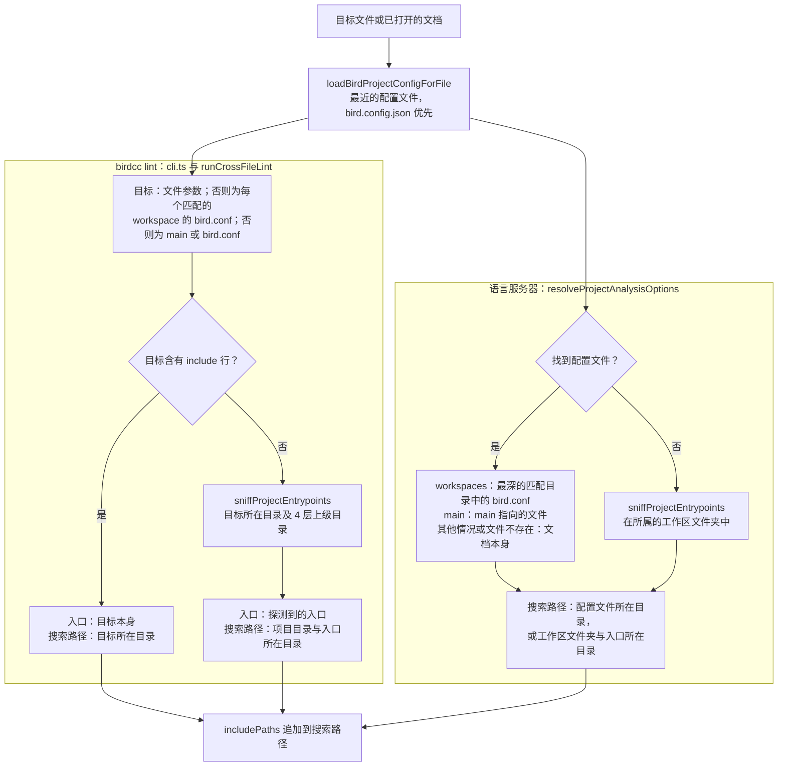

## CLI 的 lint 流程 [#cli-lint]

`birdcc lint` 加载项目配置，然后对每个目标调用 `runLint`。静态分析默认作用于 include 图；使用 `--no-cross-file` 或 `crossFile.enabled: false` 时只分析单个文件。使用 `--bird` 或 `linter.withBird` 时，`runBirdValidation` 不经 shell 运行第一个可用的校验命令模板，并把它的 stderr 转换为诊断。`linter.rules` 的级别覆盖最后生效。任一诊断的级别为 `error` 时，命令以退出码 1 结束。[用 bird -p 检查](./linting.mdx#bird)一节介绍相关选项。

箭头表示控制流。

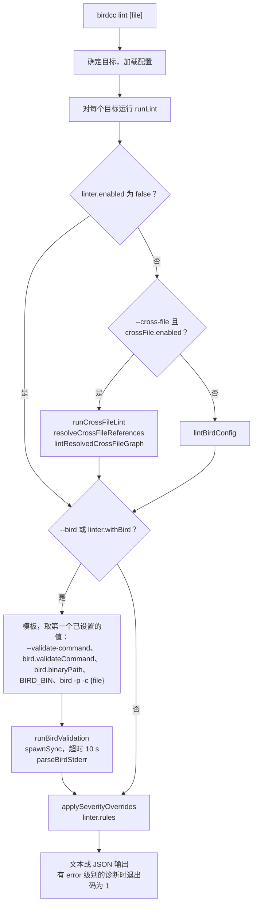

## ASN 数据流 [#asn-data]

`@birdcc/intel` 的 `scripts/build-db.ts` 从 BGP.Tools-OpenDB 的 `auto-update` 分支下载 `asns/asns.csv`，按 ASN 排序，再写出 gzip 压缩的四列 MessagePack 文件 `packages/@birdcc/intel/db/asn-db.bin.gz`。`intel-asn-update.yml` 工作流在每周一 04:00 UTC 运行这个脚本。文件有变化时，`tools/intel-release-note.mjs` 添加一个 Tegami patch changeset，工作流从 `feat/weekly-asn-database` 分支创建拉取请求。合并后的文件随下一个 `@birdcc/intel` 版本发布。`startLspServer()` 在启动时调用 `createAsnIntel()`，后者校验文件并建立查找表。除非 `bird2-lsp.intel.enabled` 或对应功能的设置（`intel.completion`、`intel.hover`、`intel.inlayHints`）为 `false`，补全、悬停提示和内嵌提示的处理函数都会查询它。[ASN 数据](./asn-data.mdx)介绍数据库和相关设置。

箭头沿数据流向，从上游 CSV 指向语言服务器功能。

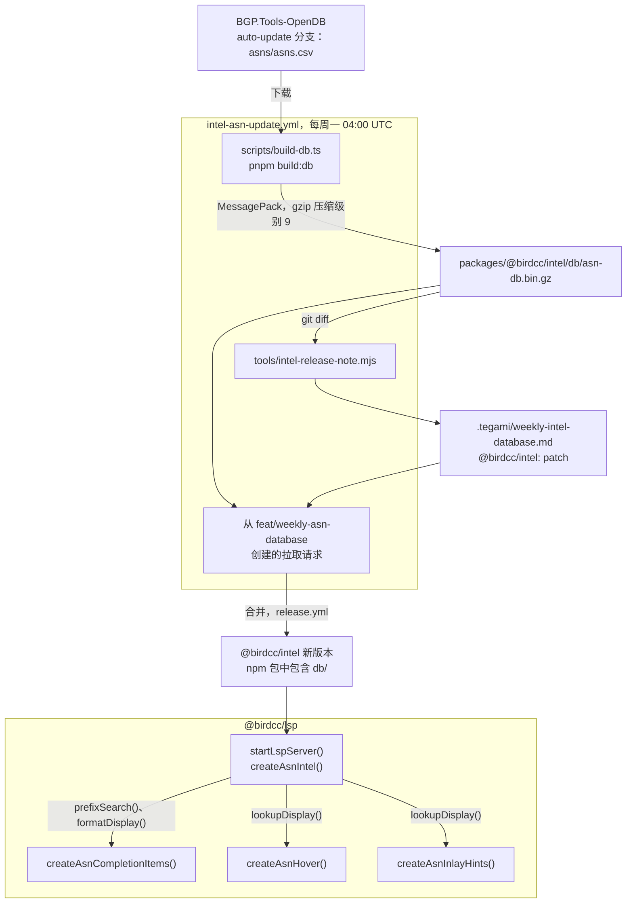

## VS Code 扩展 [#vscode-extension]

### 启动语言服务器 [#language-server-start]

扩展清单没有声明 `capabilities.untrustedWorkspaces`，所以 VS Code 只在受信任的工作区中激活扩展。`bird2-lsp.serverPath` 保持默认值 `["birdcc", "lsp", "--stdio"]`，并且扩展目录中存在 `node_modules/@birdcc/lsp/dist/server.js` 时，扩展启动内置的语言服务器。它用 VS Code 可执行文件 `process.execPath` 运行这个文件，并设置 `ELECTRON_RUN_AS_NODE=1` 和 `ELECTRON_NO_ASAR=1`，因此不需要安装 Node.js 或 `@birdcc/cli`。其他情况下，`resolveServerCommand()` 把字符串形式的 `serverPath` 拆分成参数，拒绝 shell 程序和 shell 包装命令，扩展再不经 shell 启动该命令。`client.start()` 失败或没有在 `bird2-lsp.performance.startupTimeoutMs` 内完成时，扩展终止服务器进程。在这种情况下，以及运行中的客户端并非由扩展停止而自行停止时，生命周期状态变为 `error`，扩展启动回退校验。[设置](./editors/vscode.mdx#settings)列出扩展的全部设置。

箭头从一个步骤指向下一个步骤。

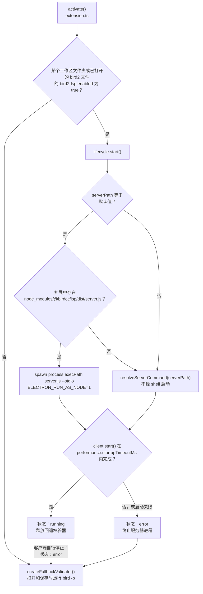

### 扩展宿主中的提供程序 [#extension-host-providers]

除了语言客户端，扩展还在扩展宿主中注册自己的提供程序。Format Document 和 Format Selection 调用 `@birdcc/formatter` 的 `formatBirdConfig()`。`loadBirdProjectConfigForFile()` 读取的 `bird.config.json` 中的 `formatter` 选项优先于扩展设置和编辑器缩进设置。Format Selection 只保留选区内的编辑。函数返回类型的悬停提示和内嵌提示调用 `@birdcc/core` 的 `collectFunctionReturnHints()`。关键字悬停提示调用 `@birdcc/lsp` 库的 `resolveKeywordHoverOnLine()`，语言服务器正在为该文件运行时它不返回内容。每个提供程序先执行 `enforceLargeFileGuard()`，再执行文档准入检查：查找 `main` 指向该文档的项目文件，并调用 `evaluateBirdDocumentEligibility()`。服务器运行期间，语言客户端还为 `bird2` 文档注册服务器的提供程序，其中包括 Format Document（`documentFormattingProvider`）、悬停提示，以及 AS 号和函数返回类型的内嵌提示。Format Selection 只有扩展宿主中的提供程序。

箭头从调用方指向被调用的模块。

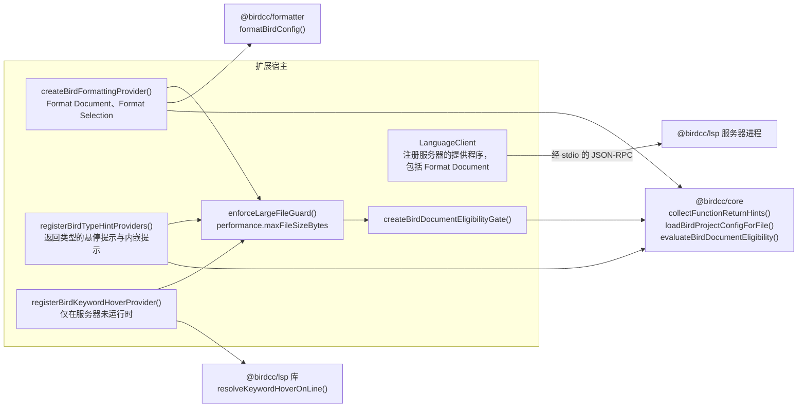

### 回退校验 [#fallback-validation]

回退校验对已保存的文件运行 BIRD 程序，并把输出转换为 `bird2-fallback` 集合中的诊断，来源为 `bird -p`。`bird2-lsp.enabled` 为 `false` 或客户端处于 `error` 状态时，存在一个后台校验器。服务器运行期间，另一个后台校验器负责资源级 `enabled` 为 `false` 的文件。后台校验器启动时校验当前文件；其他文件在打开后 800 ms 校验，`bird2-lsp.validation.onSave` 为 `true` 时也在保存后 800 ms 校验。**BIRD2: Validate Active Document** 命令使用一个单独的校验器，按需运行一次。每次运行都先通过相同的检查，再由 `execFile()` 不经 shell 启动命令。VS Code 页面的[回退校验](./editors/vscode.mdx#fallback-validation)一节列出命令模板的规则。

箭头从触发条件或步骤指向下一个步骤。

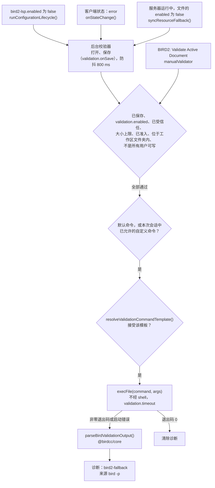
