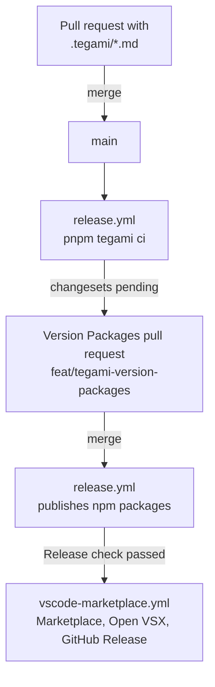

[BIRD-LSP](https://github.com/bird-chinese-community/BIRD-LSP) is a pnpm and Turborepo workspace. It contains the TypeScript packages under `packages/@birdcc/` and the Rust crate of `@birdcc/dprint-plugin-bird`. Send pull requests to the `main` branch. BIRD-LSP is licensed under [GPL-3.0-only](https://github.com/bird-chinese-community/BIRD-LSP/blob/main/LICENSE), and the [code of conduct](https://github.com/bird-chinese-community/BIRD-LSP/blob/main/CODE_OF_CONDUCT.md) applies to all project spaces.

## Requirements [#requirements]

- Node.js 22 or newer. The release tools (`pnpm tegami`, `pnpm release:status`) need Node.js 24 or newer. CI uses Node.js 24.
- pnpm 10.18.3, the version in `packageManager` of the root `package.json`.
- Rust stable with the `wasm32-unknown-unknown` target and the `llvm-tools` component. The build of `@birdcc/dprint-plugin-bird` needs them.

## Set up the workspace [#setup]

```sh
git clone https://github.com/bird-chinese-community/BIRD-LSP.git
cd BIRD-LSP
git submodule update --init --depth 1 refer/BIRD-source-code refer/BIRD-tm-language-grammar refer/BIRD2-vim-grammar
rustup target add wasm32-unknown-unknown
rustup component add llvm-tools
pnpm install
pnpm build
pnpm test
```

The three submodules contain the BIRD source code, the TextMate grammar and the Vim syntax files. CI initializes the same three submodules.

## Commands [#commands]

Run the commands in the repository root. Turborepo runs each task in every package. `build` builds the dependencies of a package first, and `test` and `test:quick` run `build` first.

| Command                                                 | Runs                                                                                       |
| ------------------------------------------------------- | ------------------------------------------------------------------------------------------ |
| `pnpm build`                                            | The build of every package. For `@birdcc/dprint-plugin-bird`, also the WebAssembly module. |
| `pnpm test`                                             | All package tests                                                                          |
| `pnpm test:quick`                                       | Package tests without the real-world configuration corpus                                  |
| `pnpm typecheck`                                        | TypeScript checks                                                                          |
| `pnpm lint`                                             | Oxlint, plus `cargo fmt --check` and `cargo clippy` for the dprint plugin                  |
| `pnpm exec turbo run format --concurrency=1 -- --check` | Oxfmt check, as in CI                                                                      |
| `pnpm format`                                           | Oxfmt, rewriting files                                                                     |
| `pnpm --filter @birdcc/parser test`                     | The tests of one package. Replace `@birdcc/parser` with the package name.                  |

The compiled grammar `packages/@birdcc/parser/src/tree-sitter-birdcc.wasm` is committed, and `pnpm build` does not regenerate it. After a change to `grammar.js`, regenerate the grammar and the WebAssembly file as described in [Grammar and WASM](https://github.com/bird-chinese-community/BIRD-LSP/blob/main/packages/@birdcc/parser/README.md#grammar-and-wasm). The WebAssembly build needs Emscripten, Docker or Podman.

## Git hooks [#hooks]

`.pre-commit-config.yaml` defines Git hooks for [prek](https://github.com/j178/prek). The root `package.json` installs prek as a dev dependency. To install the hooks in your clone:

```sh
pnpm exec prek install -t pre-commit -t commit-msg -t pre-push
```

| Hook type    | Runs                                                                                                                              |
| ------------ | --------------------------------------------------------------------------------------------------------------------------------- |
| `pre-commit` | `oxfmt` and `oxlint --deny-warnings` on the changed TypeScript files under `packages/@birdcc/*/src` and `packages/@birdcc/*/test` |
| `commit-msg` | commitlint                                                                                                                        |
| `pre-push`   | `pnpm run test:quick`                                                                                                             |

The Pre-check job of CI runs the hooks on all files.

## Commit messages [#commits]

Commit messages follow [Conventional Commits](https://www.conventionalcommits.org/en/v1.0.0/). `commitlint.config.cjs` sets these rules:

| Part    | Rule                                                                                                           |
| ------- | -------------------------------------------------------------------------------------------------------------- |
| Header  | `type(scope): Subject`, at most 72 characters                                                                  |
| Type    | Lowercase, one of `feat`, `fix`, `docs`, `style`, `refactor`, `perf`, `test`, `chore`, `revert`, `build`, `ci` |
| Scope   | Required, kebab-case                                                                                           |
| Subject | Required, sentence case (first letter uppercase), no period at the end                                         |
| Body    | Lines of at most 200 characters                                                                                |

```text
fix(parser): Handle nested blocks
docs(readme): Rewrite READMEs from 1.0.0 sources
```

commitlint rejects `fix(parser): handle nested blocks` (lowercase subject) and `fix: Handle nested blocks` (no scope). CI checks every commit of a pull request.

## Changesets [#changesets]

Tegami records pending changes as Markdown files in `.tegami/` and creates the package versions, changelogs and npm releases from them. Run `pnpm tegami`, or add a file:

```md title=".tegami/project-settings-diagnostics.md"
---
packages:
  "@birdcc/lsp": patch
---

## Apply project settings to diagnostics

Describe the resulting behavior and any required migration.

PR: https://github.com/bird-chinese-community/BIRD-LSP/pull/NUMBER
Issue: https://github.com/bird-chinese-community/BIRD-LSP/issues/NUMBER
```

- The `packages` mapping must not be empty. Select `patch`, `minor` or `major` for each affected package.
- The body needs at least one Markdown heading.
- Package names are the names in the package manifests. `npm:<name>` and `cargo:<name>` select one provider. A change to the Rust formatter can affect both `@birdcc/dprint-plugin-bird` (npm) and `dprint-plugin-bird` (Cargo).
- Replace `NUMBER` with the pull request and the issue that the change belongs to.

A pull request that changes files under `packages/` needs a changeset. Changes to Markdown files, to `test/` and `test-e2e/` directories and to `LICENSE` files do not need one. The Pre-check job of CI runs `pnpm release:status --since origin/main`. The job fails when a pull request that needs a changeset adds no changeset with a package and a heading.

`pnpm release:status` prints JSON with an entry for each package that has pending changes: the current and the next version, the bump type, whether the package is published, and the changeset files. It does not change files or publish packages. In the pull request template, list the changeset paths and the related issues under **Changeset**.

## Releases [#releases]

[docs/releasing.md](https://github.com/bird-chinese-community/BIRD-LSP/blob/main/docs/releasing.md) describes the release process. Maintainers run it through GitHub Actions:

1. On every push to `main`, the Release workflow (`release.yml`) runs lint, tests, build and type checks, then `pnpm tegami ci`.
2. When changesets are pending, Tegami opens or updates the pull request **chore(release): Version packages** from the branch `feat/tegami-version-packages`. It contains the new manifest versions, dependency ranges, changelogs, lockfiles and `.tegami/publish-lock.yaml`.
3. After a maintainer merges that pull request, the next Release run publishes the npm packages recorded in the publish lock.
4. The workflow Publish VS Code Extensions (`vscode-marketplace.yml`) runs when a push to `main` changes the manifest of the extension or of the extension pack. It waits for the Release check of the same commit, packages both VSIX files, publishes them to the VS Code Marketplace and Open VSX, and creates the GitHub Release `bird2-lsp-v<version>` with both files.

Arrows show the order of the steps.



`@birdcc/vscode` and `bird2-extension-pack` are private npm packages. Tegami sets their versions, and the VSIX files are their only published artifacts. The Cargo crate `dprint-plugin-bird` is not published. It supplies the WebAssembly file in `@birdcc/dprint-plugin-bird`.

## Edit this documentation site [#docs-site]

The source of this site is [bird-chinese-community.github.io](https://github.com/bird-chinese-community/bird-chinese-community.github.io). The site is a static export of Next.js with Fumadocs. Its development needs Node.js 24 or newer and pnpm 11.

```sh
pnpm install
pnpm dev            # http://localhost:3885
pnpm run build      # static files in out/
pnpm run check      # oxlint with type checking
pnpm run format     # oxfmt
```

- Each page is two files in `content/docs/`: `<name>.mdx` in English and `<name>.zh-cn.mdx` in Simplified Chinese. Both files have the same sections in the same order.
- `meta.json` files set the page order and the section titles of the sidebar.
- A link to another page uses the source file, for example `[CLI](./reference/cli.mdx)`. The build rewrites it to the page URL in the language of the linking page and fails on a link to a missing file.
- `design.md` contains the presentation rules of the site.
- The build reads the Git history of each page for the contributor list, so it runs in a clone with at least one commit.
- `.github/workflows/pages.yml` checks the format, runs oxlint and builds the site for every push and pull request. A push to `main` deploys the build to GitHub Pages.

The site code is licensed under the [Apache License 2.0](https://github.com/bird-chinese-community/bird-chinese-community.github.io/blob/main/LICENSE).
