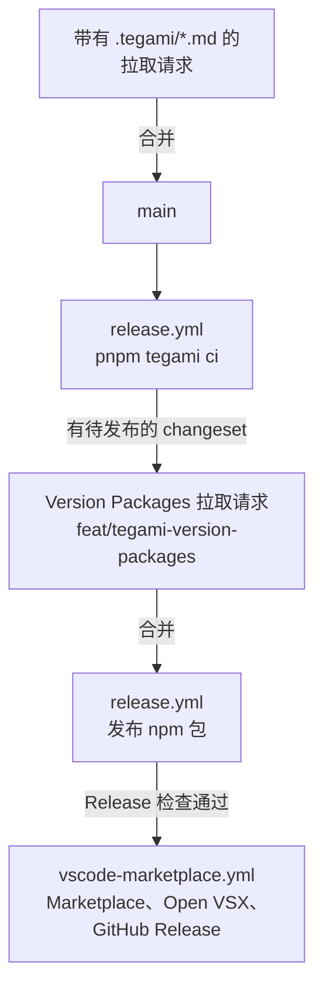

[BIRD-LSP](https://github.com/bird-chinese-community/BIRD-LSP) 是一个 pnpm 与 Turborepo 工作区，包含 `packages/@birdcc/` 下的 TypeScript 包和 `@birdcc/dprint-plugin-bird` 的 Rust crate。拉取请求请提交到 `main` 分支。BIRD-LSP 采用 [GPL-3.0-only](https://github.com/bird-chinese-community/BIRD-LSP/blob/main/LICENSE) 许可证，[行为准则](https://github.com/bird-chinese-community/BIRD-LSP/blob/main/CODE_OF_CONDUCT.md)适用于项目的所有交流场所。

## 环境要求 [#requirements]

- Node.js 22 或更新版本。发布工具（`pnpm tegami`、`pnpm release:status`）需要 Node.js 24 或更新版本。CI 使用 Node.js 24。
- pnpm 10.18.3，即根目录 `package.json` 中 `packageManager` 声明的版本。
- Rust stable，并安装 `wasm32-unknown-unknown` 目标和 `llvm-tools` 组件。构建 `@birdcc/dprint-plugin-bird` 需要它们。

## 搭建工作区 [#setup]

```sh
git clone https://github.com/bird-chinese-community/BIRD-LSP.git
cd BIRD-LSP
git submodule update --init --depth 1 refer/BIRD-source-code refer/BIRD-tm-language-grammar refer/BIRD2-vim-grammar
rustup target add wasm32-unknown-unknown
rustup component add llvm-tools
pnpm install
pnpm build
pnpm test
```

这三个子模块分别是 BIRD 源码、TextMate 语法和 Vim 语法文件。CI 也初始化同样的三个子模块。

## 常用命令 [#commands]

在仓库根目录运行这些命令。Turborepo 在每个包中运行对应任务。`build` 先构建包的依赖，`test` 和 `test:quick` 先运行 `build`。

| 命令                                                    | 作用                                                                 |
| ------------------------------------------------------- | -------------------------------------------------------------------- |
| `pnpm build`                                            | 构建所有包。`@birdcc/dprint-plugin-bird` 还会构建 WebAssembly 模块。 |
| `pnpm test`                                             | 运行所有包的测试                                                     |
| `pnpm test:quick`                                       | 运行各包测试，不包括真实配置语料                                     |
| `pnpm typecheck`                                        | TypeScript 类型检查                                                  |
| `pnpm lint`                                             | Oxlint，以及 dprint 插件的 `cargo fmt --check` 和 `cargo clippy`     |
| `pnpm exec turbo run format --concurrency=1 -- --check` | 与 CI 相同的 Oxfmt 格式检查                                          |
| `pnpm format`                                           | 用 Oxfmt 格式化并改写文件                                            |
| `pnpm --filter @birdcc/parser test`                     | 运行单个包的测试。把 `@birdcc/parser` 换成目标包名。                 |

编译好的语法文件 `packages/@birdcc/parser/src/tree-sitter-birdcc.wasm` 已提交到仓库，`pnpm build` 不会重新生成它。修改 `grammar.js` 后，按照 [Grammar and WASM](https://github.com/bird-chinese-community/BIRD-LSP/blob/main/packages/@birdcc/parser/README.md#grammar-and-wasm) 一节重新生成语法和 WebAssembly 文件。构建 WebAssembly 文件需要 Emscripten、Docker 或 Podman。

## Git 钩子 [#hooks]

`.pre-commit-config.yaml` 为 [prek](https://github.com/j178/prek) 定义了 Git 钩子。根目录 `package.json` 把 prek 安装为开发依赖。在你的克隆中安装钩子：

```sh
pnpm exec prek install -t pre-commit -t commit-msg -t pre-push
```

| 钩子类型     | 运行内容                                                                                                                  |
| ------------ | ------------------------------------------------------------------------------------------------------------------------- |
| `pre-commit` | 对 `packages/@birdcc/*/src` 和 `packages/@birdcc/*/test` 下改动的 TypeScript 文件运行 `oxfmt` 和 `oxlint --deny-warnings` |
| `commit-msg` | commitlint                                                                                                                |
| `pre-push`   | `pnpm run test:quick`                                                                                                     |

CI 的 Pre-check 任务对所有文件运行这些钩子。

## 提交信息 [#commits]

提交信息遵循 [Conventional Commits](https://www.conventionalcommits.org/en/v1.0.0/)。`commitlint.config.cjs` 设置了以下规则：

| 部分    | 规则                                                                                                           |
| ------- | -------------------------------------------------------------------------------------------------------------- |
| 标题行  | `type(scope): Subject`，最多 72 个字符                                                                         |
| type    | 小写，取值为 `feat`、`fix`、`docs`、`style`、`refactor`、`perf`、`test`、`chore`、`revert`、`build`、`ci` 之一 |
| scope   | 必填，kebab-case                                                                                               |
| subject | 必填，句首大写（sentence case），结尾不加句号                                                                  |
| 正文    | 每行最多 200 个字符                                                                                            |

```text
fix(parser): Handle nested blocks
docs(readme): Rewrite READMEs from 1.0.0 sources
```

commitlint 会拒绝 `fix(parser): handle nested blocks`（subject 首字母小写）和 `fix: Handle nested blocks`（缺少 scope）。CI 检查拉取请求中的每个提交。

## Changeset [#changesets]

Tegami 把待发布的改动记录为 `.tegami/` 下的 Markdown 文件，并据此生成包版本、更新日志和 npm 发布。运行 `pnpm tegami`，或者手动添加文件：

```md title=".tegami/project-settings-diagnostics.md"
---
packages:
  "@birdcc/lsp": patch
---

## Apply project settings to diagnostics

Describe the resulting behavior and any required migration.

PR: https://github.com/bird-chinese-community/BIRD-LSP/pull/NUMBER
Issue: https://github.com/bird-chinese-community/BIRD-LSP/issues/NUMBER
```

- `packages` 映射不能为空。为每个受影响的包选择 `patch`、`minor` 或 `major`。
- 正文至少需要一个 Markdown 标题。
- 包名是各包清单文件中的名称。`npm:<name>` 和 `cargo:<name>` 指定单个提供方。修改 Rust 格式化器可能同时影响 `@birdcc/dprint-plugin-bird`（npm）和 `dprint-plugin-bird`（Cargo）。
- 把 `NUMBER` 换成改动所属的拉取请求和 issue 编号。

修改 `packages/` 下文件的拉取请求需要 changeset。只改动 Markdown 文件、`test/` 和 `test-e2e/` 目录或 `LICENSE` 文件时不需要。CI 的 Pre-check 任务运行 `pnpm release:status --since origin/main`。需要 changeset 的拉取请求没有添加带包名和标题的 changeset 时，该任务失败。

`pnpm release:status` 输出 JSON，为每个有待发布改动的包列出当前版本、下一个版本、升级类型、是否发布以及 changeset 文件。它不修改文件，也不发布包。在拉取请求模板的 **Changeset** 部分列出 changeset 路径和相关 issue。

## 发布 [#releases]

[docs/releasing.md](https://github.com/bird-chinese-community/BIRD-LSP/blob/main/docs/releasing.md) 说明发布流程。维护者通过 GitHub Actions 完成发布：

1. 每次推送到 `main` 时，Release 工作流（`release.yml`）运行 lint、测试、构建和类型检查，然后运行 `pnpm tegami ci`。
2. 存在待发布的 changeset 时，Tegami 从 `feat/tegami-version-packages` 分支创建或更新拉取请求 **chore(release): Version packages**。其中包含新的清单版本、依赖范围、更新日志、锁文件和 `.tegami/publish-lock.yaml`。
3. 维护者合并这个拉取请求后，下一次 Release 运行发布 publish lock 中记录的 npm 包。
4. 推送到 `main` 的提交修改了扩展或扩展包的清单文件时，Publish VS Code Extensions 工作流（`vscode-marketplace.yml`）运行。它等待同一提交的 Release 检查完成，打包两个 VSIX 文件，发布到 VS Code Marketplace 和 Open VSX，并创建带有这两个文件的 GitHub Release `bird2-lsp-v<version>`。

箭头表示步骤的先后顺序。



`@birdcc/vscode` 和 `bird2-extension-pack` 是私有 npm 包。Tegami 管理它们的版本，发布的产物只有 VSIX 文件。Cargo crate `dprint-plugin-bird` 不单独发布，它提供 `@birdcc/dprint-plugin-bird` 中的 WebAssembly 文件。

## 修改本文档站 [#docs-site]

本站的源码位于 [bird-chinese-community.github.io](https://github.com/bird-chinese-community/bird-chinese-community.github.io)。本站是用 Fumadocs 构建的 Next.js 静态导出站点。开发需要 Node.js 24 或更新版本以及 pnpm 11。

```sh
pnpm install
pnpm dev            # http://localhost:3885
pnpm run build      # static files in out/
pnpm run check      # oxlint with type checking
pnpm run format     # oxfmt
```

- 每个页面对应 `content/docs/` 下的两个文件：英文的 `<name>.mdx` 和简体中文的 `<name>.zh-cn.mdx`。两个文件的章节相同，顺序也相同。
- `meta.json` 文件设置侧边栏的页面顺序和分组标题。
- 链接到其他页面时使用源文件路径，例如 `[CLI](./reference/cli.mdx)`。构建时，链接会被改写为与当前页面同语言的页面 URL；目标文件不存在时构建失败。
- `design.md` 记录本站的展示规则。
- 构建会读取每个页面的 Git 历史来生成贡献者列表，因此必须在至少有一个提交的克隆中运行。
- `.github/workflows/pages.yml` 在每次推送和每个拉取请求上检查格式、运行 oxlint 并构建站点。推送到 `main` 时，构建结果部署到 GitHub Pages。

本站代码采用 [Apache License 2.0](https://github.com/bird-chinese-community/bird-chinese-community.github.io/blob/main/LICENSE) 许可证。
