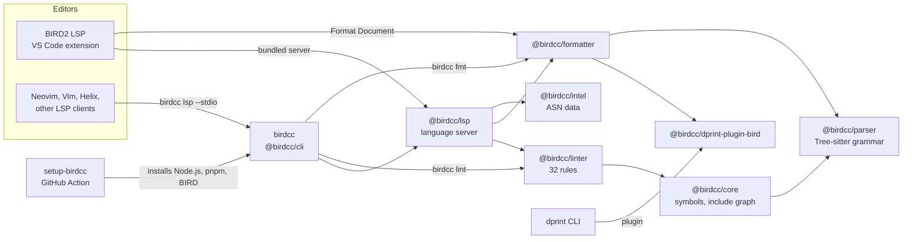

The BIRD Chinese Community (BIRDCC) maintains tools for the configuration files of BIRD 2 and BIRD 3, the BIRD Internet Routing Daemon. This documentation describes BIRD-LSP 1.0.0.

## What the tools do

The tools parse BIRD configuration with a Tree-sitter grammar compiled to WebAssembly. The parser recovers from syntax errors, so the analysis still covers declarations after an error.

Analysis follows `include` statements across files, by default up to 16 levels and 256 files, and reports diagnostics from 32 lint rules.

Formatting uses a dprint plugin written in Rust or a built-in formatter. Safe mode rejects formatter output whose declarations or parse errors differ from the input.

The same analysis runs in two places:

- In an editor, through the language server `@birdcc/lsp`. The VS Code extension BIRD2 LSP contains the server. Neovim, Vim, Helix and other LSP clients start it with `birdcc lsp --stdio`.
- In a terminal or a CI job, through the `birdcc` command of `@birdcc/cli`:
  - `birdcc lint` checks files.
  - `birdcc fmt` formats them.
  - `birdcc init` writes the project configuration `bird.config.json`.

## How the parts connect

An arrow points from a component to a component that it uses. The labels name the connection.

- The VS Code extension starts the bundled language server with the JavaScript runtime of VS Code, so it does not need Node.js.
- `birdcc` needs Node.js 22 or newer.
- [setup-birdcc](https://github.com/bird-chinese-community/setup-birdcc) prepares a GitHub Actions runner: it installs Node.js, pnpm and BIRD (BIRD 2 by default, or BIRD 3). The steps after it run `birdcc lint`, `birdcc fmt --check` and `bird -p`.
- `@birdcc/dprint-plugin-bird` is the default formatting engine of `@birdcc/formatter`. The dprint CLI can also load it as a plugin.

## Sections

<Cards>
  <Card
    icon={<Rocket />}
    title="Getting started"
    description="Install the editor extension and the CLI, then check a configuration file."
    href="./getting-started.mdx"
  />
  <Card
    icon={<Code />}
    title="Editors"
    description="BIRD2 LSP for VS Code, and setup for Neovim, Vim, Helix and other editors."
    href="./editors/vscode.mdx"
  />
  <Card
    icon={<ListChecks />}
    title="Linting"
    description="Run birdcc lint, read diagnostics and change rule severities."
    href="./linting.mdx"
  />
  <Card
    icon={<Paintbrush />}
    title="Formatting"
    description="Format files with the dprint or the built-in engine, with safe mode."
    href="./formatting.mdx"
  />
  <Card
    icon={<FileCog />}
    title="Project configuration"
    description="Set the entry file, workspaces and include paths in bird.config.json."
    href="./project-configuration.mdx"
  />
  <Card
    icon={<Workflow />}
    title="CI"
    description="Lint, format-check and parse-check configurations in GitHub Actions."
    href="./ci.mdx"
  />
  <Card
    icon={<BookOpen />}
    title="Reference"
    description="CLI options, configuration keys, rules, language server and packages."
    href="./reference/cli.mdx"
  />
  <Card
    icon={<Bot />}
    title="llms.txt"
    description="Page index for LLMs and AI agents. llms-full.txt has the text of every page in one file."
    href="/en/llms.txt"
    external
  />
</Cards>

## Projects

The organization [bird-chinese-community](https://github.com/bird-chinese-community) publishes these repositories:

| Repository                                                                                     | Contents                                                                                                                                      |
| ---------------------------------------------------------------------------------------------- | --------------------------------------------------------------------------------------------------------------------------------------------- |
| [BIRD-LSP](https://github.com/bird-chinese-community/BIRD-LSP)                                 | The npm packages `@birdcc/*`, the `birdcc` CLI, the BIRD2 LSP extension and the BIRD2 Extension Pack.                                         |
| [BIRD.nvim](https://github.com/bird-chinese-community/BIRD.nvim)                               | Neovim plugin: filetype detection and syntax highlighting for the `bird2` filetype.                                                           |
| [BIRD.vim](https://github.com/bird-chinese-community/BIRD.vim)                                 | Vim plugin: filetype detection, syntax highlighting and a filetype plugin for the `bird2` filetype.                                           |
| [BIRD-tm-language-grammar](https://github.com/bird-chinese-community/BIRD-tm-language-grammar) | TextMate grammar `bird2.tmLanguage.json` (scope `source.bird2`), also used as a TextMate bundle in JetBrains IDEs.                            |
| [vscode-bird2](https://github.com/bird-chinese-community/vscode-bird2)                         | VS Code extension BIRD2 Configuration (`BIRDCC.vscode-bird2-conf`): syntax highlighting with the TextMate grammar.                            |
| [setup-birdcc](https://github.com/bird-chinese-community/setup-birdcc)                         | GitHub Action that installs Node.js, pnpm and BIRD 2 or BIRD 3 on a runner for jobs that run `birdcc` and `bird -p`.                          |
| [BIRD.skills](https://github.com/bird-chinese-community/BIRD.skills)                           | Agent skills for BIRD configuration work, editor and CLI installation, GitHub Actions workflows, BIRD source research and incident diagnosis. |
| [bird-docs-query-mcp](https://github.com/bird-chinese-community/bird-docs-query-mcp)           | MCP server over stdio that searches the BIRD documentation for matching sections.                                                             |
| [bird2-autotype](https://github.com/bird-chinese-community/bird2-autotype)                     | Python tool that adds explicit return types to function declarations in configurations for BIRD 2.17 or newer.                                |

BIRD is developed by CZ.NIC Labs. BIRDCC is not affiliated with CZ.NIC.
