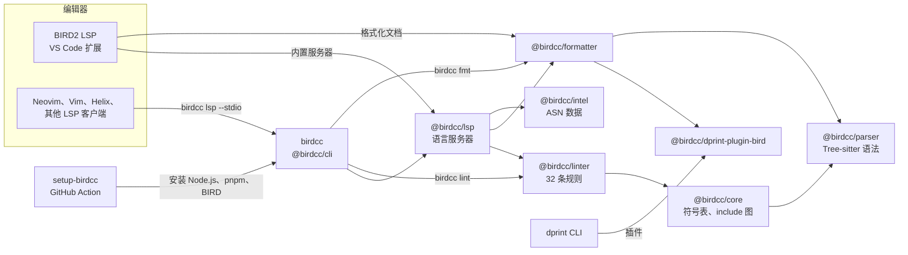

BIRD 中文社区（BIRDCC）维护一组用于 BIRD 2 与 BIRD 3 配置文件的工具。BIRD 指 BIRD Internet Routing Daemon。本文档对应 BIRD-LSP 1.0.0。

## 工具的作用

工具用编译成 WebAssembly 的 Tree-sitter 语法解析 BIRD 配置。解析器遇到语法错误后继续解析，错误之后的声明照常参与分析。分析会跟随 `include` 语句读取其他文件，默认最多 16 层、256 个文件，并报告 32 条 lint 规则的诊断。格式化使用 Rust 编写的 dprint 插件或内置格式化器。安全模式会拒绝声明或解析错误与输入不一致的格式化结果。

同一套分析在两个地方运行：

- 在编辑器中，通过语言服务器 `@birdcc/lsp` 运行。VS Code 扩展 BIRD2 LSP 内置这个服务器。Neovim、Vim、Helix 和其他 LSP 客户端用 `birdcc lsp --stdio` 启动它。
- 在终端或 CI 任务中，通过 `@birdcc/cli` 提供的 `birdcc` 命令运行：`birdcc lint` 检查文件，`birdcc fmt` 格式化文件，`birdcc init` 写出项目配置 `bird.config.json`。

## 各部分的关系

箭头从一个组件指向它使用的组件，箭头上的文字说明两者的关系。

- VS Code 扩展用 VS Code 自带的 JavaScript 运行时启动内置的语言服务器，不需要安装 Node.js。
- `birdcc` 需要 Node.js 22 或更新版本。
- [setup-birdcc](https://github.com/bird-chinese-community/setup-birdcc) 准备 GitHub Actions runner：安装 Node.js、pnpm 和 BIRD（默认 BIRD 2，可选 BIRD 3）。之后的步骤运行 `birdcc lint`、`birdcc fmt --check` 和 `bird -p`。
- `@birdcc/dprint-plugin-bird` 是 `@birdcc/formatter` 的默认格式化引擎。dprint CLI 也可以把它作为插件加载。

## 章节

<Cards>
  <Card
    icon={<Rocket />}
    title="快速上手"
    description="安装编辑器扩展和 CLI，然后检查一个配置文件。"
    href="./getting-started.mdx"
  />
  <Card
    icon={<Code />}
    title="编辑器"
    description="VS Code 扩展 BIRD2 LSP，以及 Neovim、Vim、Helix 和其他编辑器的配置方法。"
    href="./editors/vscode.mdx"
  />
  <Card
    icon={<ListChecks />}
    title="Lint 检查"
    description="运行 birdcc lint，阅读诊断，修改规则级别。"
    href="./linting.mdx"
  />
  <Card
    icon={<Paintbrush />}
    title="格式化"
    description="用 dprint 引擎或内置引擎格式化文件，以及安全模式。"
    href="./formatting.mdx"
  />
  <Card
    icon={<FileCog />}
    title="项目配置"
    description="在 bird.config.json 中设置入口文件、工作区目录和 include 搜索路径。"
    href="./project-configuration.mdx"
  />
  <Card
    icon={<Workflow />}
    title="CI"
    description="在 GitHub Actions 中做 lint 检查、格式检查和 bird -p 解析检查。"
    href="./ci.mdx"
  />
  <Card
    icon={<BookOpen />}
    title="参考"
    description="CLI 选项、配置项、规则、语言服务器和各个包。"
    href="./reference/cli.mdx"
  />
</Cards>

## 项目

组织 [bird-chinese-community](https://github.com/bird-chinese-community) 发布了以下仓库：

| 仓库                                                                                           | 内容                                                                                                                 |
| ---------------------------------------------------------------------------------------------- | -------------------------------------------------------------------------------------------------------------------- |
| [BIRD-LSP](https://github.com/bird-chinese-community/BIRD-LSP)                                 | npm 包 `@birdcc/*`、`birdcc` 命令、BIRD2 LSP 扩展和 BIRD2 Extension Pack 扩展包。                                    |
| [BIRD.nvim](https://github.com/bird-chinese-community/BIRD.nvim)                               | Neovim 插件：为 `bird2` 文件类型提供文件类型识别和语法高亮。                                                         |
| [BIRD.vim](https://github.com/bird-chinese-community/BIRD.vim)                                 | Vim 插件：为 `bird2` 文件类型提供文件类型识别、语法高亮和文件类型插件。                                              |
| [BIRD-tm-language-grammar](https://github.com/bird-chinese-community/BIRD-tm-language-grammar) | TextMate 语法 `bird2.tmLanguage.json`（scope 为 `source.bird2`），也可以作为 JetBrains IDE 的 TextMate Bundle 使用。 |
| [vscode-bird2](https://github.com/bird-chinese-community/vscode-bird2)                         | VS Code 扩展 BIRD2 Configuration（`BIRDCC.vscode-bird2-conf`）：用这份 TextMate 语法提供语法高亮。                   |
| [setup-birdcc](https://github.com/bird-chinese-community/setup-birdcc)                         | GitHub Action：在 runner 上安装 Node.js、pnpm 和 BIRD 2 或 BIRD 3，供运行 `birdcc` 与 `bird -p` 的任务使用。         |
| [BIRD.skills](https://github.com/bird-chinese-community/BIRD.skills)                           | Agent 技能：编写与检查 BIRD 配置、安装编辑器支持和 CLI、编写 GitHub Actions 工作流、研究 BIRD 源码、诊断运行故障。   |
| [bird-docs-query-mcp](https://github.com/bird-chinese-community/bird-docs-query-mcp)           | 通过 stdio 通信的 MCP 服务器，在 BIRD 文档中查找与查询相关的章节。                                                   |
| [bird2-autotype](https://github.com/bird-chinese-community/bird2-autotype)                     | Python 工具，为 BIRD 2.17 及更新版本的配置文件中的函数声明补全显式返回类型。                                         |

BIRD 由 CZ.NIC Labs 开发。BIRDCC 与 CZ.NIC 没有隶属关系。
