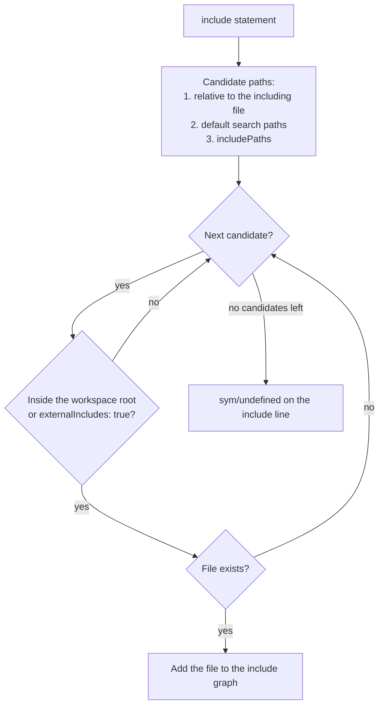

`bird.config.json` describes a BIRD project for `birdcc lint`, `birdcc fmt` and the language server. It names the entry file or the workspace directories, adds include search paths, and sets the options of the linter, the formatter and the cross-file analysis. The [configuration reference](./reference/configuration.mdx) lists every key.

```json title="bird.config.json"
{
  "$schema": "https://raw.githubusercontent.com/bird-chinese-community/BIRD-LSP/main/schemas/bird.config.schema.json",
  "main": "bird.conf",
  "includePaths": ["./filters"],
  "linter": { "rules": { "sym/*": "error" } }
}
```

## File name and location [#file-name]

- birdcc and the language server read `bird.config.json`. `birdcc.config.json` is an alias with the same format. When both files are in one directory, `bird.config.json` is used.
- The search starts in the directory of the file and continues through each parent directory to the root of the file system. The first configuration file found applies. Configuration files in other directories are not merged.
- Paths in the file (`main`, `workspaces`, `includePaths`) are relative to the directory of the configuration file.
- The file is plain JSON. Comments and trailing commas are parse errors.

When the file is not valid, `birdcc lint` and `birdcc fmt` exit with status 1 and print the problem:

```text
Invalid BIRD project config at /srv/bird/bird.config.json: crossFile.maxDepth: Too small: expected number to be >=1; crossFile: Unrecognized key: "follow"
```

The language server reports the same message as a `config/invalid` diagnostic on the configuration file. It publishes no other diagnostics for the documents that use the file. [Validation](./reference/configuration.mdx#validation) lists the checks.

## Create the file with birdcc init [#init]

```sh
birdcc init --dry-run
birdcc init --write
```

`birdcc init` scans a directory, detects the entry file and writes `bird.config.json` into that directory. `--dry-run` prints the result and writes nothing. For a project with `bird.conf`, `filters.conf` and `peers/transit.conf`, the output is:

```text
Detected candidates:
  bird.conf                                score:143  [canonical-name, root-level, global-router-id, protocol-device, protocol-kernel, log-directive, include-count(2), bird-eligibility(canonical-filename), visited-count(2)]
  filters.conf                             score:  5  [root-level, library-name-penalty(filter), bird-eligibility(semantic-evidence)]
  peers/transit.conf                       score: -5  [fragment-dir-penalty(peers), bird-eligibility(semantic-evidence)]

Conclusion: single (confidence: 100%)
→ Will write: {"$schema":"https://raw.githubusercontent.com/bird-chinese-community/BIRD-LSP/main/schemas/bird.config.schema.json","main":"./bird.conf","formatter":{"indentSize":2}}
```

`birdcc init --write` then writes:

```json title="bird.config.json"
{
  "$schema": "https://raw.githubusercontent.com/bird-chinese-community/BIRD-LSP/main/schemas/bird.config.schema.json",
  "main": "./bird.conf",
  "formatter": {
    "indentSize": 2
  }
}
```

- A selected entry file gives `main`. Several independent entry files give `workspaces` with one directory for each entry file.
- `formatter.indentSize` is present when init detects an indentation of 2, 4 or 8 spaces in up to 5 entry files.
- When the result has no selected entry file and no workspace directories, `birdcc init --write` writes nothing and exits with status 1. Set `main` by hand in that case.
- When the file exists and sets `main` or `workspaces`, `init` changes nothing and exits with status 0. When the file exists without these keys, `--write` fails. `--force` overwrites the file in both cases.

The [`init` reference](./reference/cli.mdx#init) lists the options.

## Entry detection [#entry-detection]

The entry file is the root of the include graph: the analysis starts there and follows its `include` statements. Three callers run the same detection:

| Caller          | Scanned directory                                                            | When                                                                           | Scan limits            |
| --------------- | ---------------------------------------------------------------------------- | ------------------------------------------------------------------------------ | ---------------------- |
| `birdcc init`   | The `root` argument, or the current directory                                | Every run                                                                      | 8 levels, 20,000 files |
| `birdcc lint`   | The directory of the linted file, then each of up to four parent directories | Cross-file analysis is on, and the linted file contains no `include` statement | 8 levels, 2,000 files  |
| Language server | The workspace folder that contains the document                              | No `bird.config.json` or `birdcc.config.json` applies to the document          | 8 levels, 20,000 files |

`birdcc lint` runs detection in each of the five directories. It uses the selected entry file with the highest score and stops at the first one that scores 80 or more. After start, the language server also runs detection in each workspace folder without a configuration file at its root. It shows the result in a [notification](./reference/language-server.mdx#notifications).

Detection works in these steps:

1. It collects `.conf` files breadth-first and reads at most 20,000 directory entries and 2,048 directories. It skips hidden directories, symbolic links and the directories `node_modules`, `dist`, `build`, `target`, `vendor`, `coverage`, `__tests__`, `test`, `tests`, `fixtures`, `examples`, `example` and `docs`. `birdcc init --ignore` adds directory names to this list. Detection does not scan `/` or a directory directly below it, such as `/etc`.
2. It scores at most 100 files. Files with a name from the `canonical-name` row below come first, then the files closer to the scanned directory.
3. It keeps a file as a candidate only when the file has BIRD evidence: the name `bird.conf`, `bird2.conf`, `bird3.conf` or `bird6.conf` (with or without a leading dot, in any letter case), or BIRD declarations that the parser finds. Other files get the `rejected-no-bird-evidence` signal.
4. It adds the points of the signals in the table below. `birdcc init --dry-run` prints the signals of each candidate.
5. It builds the include graph of the candidates and selects a result.

| Signal                               | Points                                  | Condition                                                                                                                                          |
| ------------------------------------ | --------------------------------------- | -------------------------------------------------------------------------------------------------------------------------------------------------- |
| `canonical-name`                     | +25                                     | The file name is `bird.conf`, `bird2.conf`, `bird3.conf`, `bird6.conf`, `.bird2.conf` or `.bird3.conf`.                                            |
| `root-level`                         | +10                                     | The file is in the scanned directory.                                                                                                              |
| `global-router-id`                   | +50                                     | A top-level `router id` statement.                                                                                                                 |
| `protocol-router-id`                 | +10                                     | `router id` statements only inside `protocol` blocks.                                                                                              |
| `protocol-device`, `protocol-kernel` | +20 each                                | A `protocol device` or `protocol kernel` block.                                                                                                    |
| `log-directive`                      | +10                                     | A `log` statement.                                                                                                                                 |
| `include-count(n)`                   | +2 for each `include`, at most +20      | The file contains `include` statements.                                                                                                            |
| `bird-eligibility(reason)`           | +15, or 0 with `canonical-name`         | The file has BIRD evidence. The reason is `canonical-filename` or `semantic-evidence`.                                                             |
| `fragment-dir-penalty(dir)`          | −20 for each directory                  | A directory in the path is `filter`, `filters`, `peer`, `peers`, `snippet`, `snippets`, `template` or `templates`.                                 |
| `library-name-penalty(word)`         | −20                                     | The file name contains `var`, `filter`, `func` or `macro`.                                                                                         |
| `define-only-no-protocol`            | −15                                     | `define` statements and no `protocol` block.                                                                                                       |
| `visited-count(n)`                   | +2 for each reachable file, at most +30 | The file reaches other files through `include`. Only the 5 best candidates get this signal.                                                        |
| `missing-includes(n)`                | −10                                     | More than 5 included files do not exist.                                                                                                           |
| `include-propagation(file,depth:n)`  | Points of `file` × 0.8ⁿ                 | The file includes `file` through `n` levels (1 to 3). Only the `global-router-id`, `protocol-device` and `protocol-kernel` points of `file` count. |

Detection also gives each candidate a role:

- A file without `protocol` blocks is a library when one of these is true: it has `define` or top-level `router id` statements, its name contains a word such as `vars`, `filter`, `func`, `macro`, `define`, `common` or `helper`, or it declares only constants, filters, functions, tables and templates.
- A file with `protocol` blocks is a fragment when it is in a directory such as `filters`, `peers`, `templates`, `includes`, `common` or `shared`.

An entry contender is a candidate that no other scanned file includes. It must also have the `canonical-name` signal or be neither a library nor a fragment. The result is one of these conclusions:

| Conclusion             | Condition                                                                                                                                                                                                                                                                                   | Confidence              | Selected entry file                               |
| ---------------------- | ------------------------------------------------------------------------------------------------------------------------------------------------------------------------------------------------------------------------------------------------------------------------------------------- | ----------------------- | ------------------------------------------------- |
| `not-found`            | No candidate, or no entry contender.                                                                                                                                                                                                                                                        | 100 or 50               | None.                                             |
| `single`               | One entry contender, or the best contender scores more than 30 points above the second.                                                                                                                                                                                                     | 50 + score, at most 100 | The best contender when confidence is 70 or more. |
| `single-ambiguous`     | The best contender scores 30 points or less above the second.                                                                                                                                                                                                                               | 10 to 60                | None.                                             |
| `monorepo-multi-role`  | Only one contender has a positive score, and library files with the same name are in several directories. Or: the include graphs of the contenders share 30% or more of their files, no other contender reaches 70% of the best score, and the other contenders are in several directories. | 70                      | The best contender.                               |
| `monorepo-multi-entry` | Contenders with a positive score are in more than one directory, and the result is not `monorepo-multi-role`.                                                                                                                                                                               | 70                      | None. `init` writes `workspaces`.                 |

`init` writes a selected entry file as `main`. `birdcc lint` and the language server use it as the entry of the include graph. For `monorepo-multi-entry`, `init` writes the directory of each contender with a positive score that is not a library or a fragment.

## main and workspaces [#entry-files]

Set `main` for a project with one entry file:

```json title="bird.config.json"
{
  "main": "bird.conf"
}
```

- `birdcc lint` and `birdcc fmt` without a file argument use the `main` file. When `main` is not set, they use `bird.conf` in the directory of the configuration file.
- With a file argument, `birdcc lint` lints that file and finds the entry of its include graph with [entry detection](#entry-detection). It does not use `main` for this.
- The language server uses the `main` file as the entry for every document below the configuration file. A document that the include graph of `main` does not reach is analyzed on its own.
- When the `main` file does not exist, `birdcc lint` and `birdcc fmt` fail, and the language server analyzes each open document on its own.

Set `workspaces` for a repository with several entry files. Each pattern matches directories, and the entry file of each matched directory is its `bird.conf`:

```json title="bird.config.json"
{
  "workspaces": ["sites/*", "!sites/legacy"]
}
```

- `birdcc lint` without a file argument lints the `bird.conf` of every matched directory. It skips matched directories without `bird.conf`.
- `birdcc fmt` needs a file argument when `workspaces` is set.
- The language server uses the `bird.conf` of the deepest matched directory that contains the document. When no pattern matches, it uses the `bird.conf` in the directory of the document. When that file does not exist, the document is its own entry.
- `main` is ignored when `workspaces` is set.

The [`workspaces` reference](./reference/configuration.mdx#workspaces) describes the pattern syntax.

## Include resolution [#include-resolution]

birdcc and the language server resolve each `include` path against a list of candidate paths, in this order:

1. The path relative to the directory of the file that contains the `include`. An absolute path is used as it is.
2. The default search paths:
   - `birdcc lint`: the directory of the linted file when that file contains an `include` statement. Otherwise, the directory where entry detection selected the entry file, and the directory of the entry file. When detection selects nothing, the directory of the linted file.
   - Language server with a configuration file: the directory of the configuration file.
   - Language server without a configuration file: the workspace folder and the directory of the detected entry file. When detection selects nothing, there is no default search path.
3. Each entry of `includePaths`, in order, relative to the configuration file.

For each search path, the full `include` path is tried first, then the path without its leading directories: `a/b/c.conf`, then `b/c.conf`, then `c.conf`. A `*` in the file name part, as in `include "peers/*.conf";`, matches the files of that directory in name order. A `*` in a directory part is not expanded.



An `include` that resolves to no file produces `sym/undefined` diagnostics on the `include` line.

### Includes outside the workspace root [#external-includes]

birdcc and the language server skip a candidate path outside the workspace root and report `[semantic/missing-include] Include skipped outside workspace root '<root>': '<path>'` as `sym/undefined`. Set `crossFile.externalIncludes` to `true` to allow these paths.

| Tool and configuration                       | Workspace root                                                                                                                                                                      |
| -------------------------------------------- | ----------------------------------------------------------------------------------------------------------------------------------------------------------------------------------- |
| `birdcc lint`                                | The directory of the linted file when the file contains an `include` statement or when detection selects nothing. Otherwise, the directory where detection selected the entry file. |
| Language server with `workspaces`            | The matched workspace directory.                                                                                                                                                    |
| Language server with another configuration   | The directory of the configuration file.                                                                                                                                            |
| Language server without a configuration file | The workspace folder that contains the document, or the directory of the document when no workspace folder contains it.                                                             |

An `includePaths` entry outside the workspace root therefore needs `externalIncludes`. Two examples:

- `"workspaces": ["sites/*"]` with `"includePaths": ["./shared"]`: `shared/` is outside every workspace directory.
- `"main": "configs/main.conf"` with `"includePaths": ["./filters"]`: when `main.conf` contains an `include` statement, `birdcc lint` uses `configs/` as the workspace root, and `filters/` is outside it.

## Analysis limits [#limits]

The `crossFile` keys limit the include graph of one analysis:

| Key                          | Default           | Range     | Limit                                         |
| ---------------------------- | ----------------- | --------- | --------------------------------------------- |
| `crossFile.maxDepth`         | 16                | 1 to 64   | Nesting depth of `include` statements.        |
| `crossFile.maxFiles`         | 256               | 1 to 1024 | Number of files in the include graph.         |
| `crossFile.maxDocumentBytes` | 2097152 (2 MiB)   | 1 or more | UTF-8 size of one file.                       |
| `crossFile.maxTotalBytes`    | 16777216 (16 MiB) | 1 or more | UTF-8 size of all files in the include graph. |

- An included file that exceeds a limit is skipped and reported as `sym/undefined`. Each file is analyzed once, so circular includes stop before they reach `maxDepth`.
- `birdcc lint` fails with status 1 when the linted file is larger than `maxDocumentBytes` or `maxTotalBytes`. It prints `Analysis size limit (<n> bytes) exceeded: '<uri>'`.
- `--include-max-depth` and `--include-max-files` override `maxDepth` and `maxFiles` for one `birdcc lint` run.
- The language server does not analyze an open document that exceeds the size limit and reports `analysis/size-limit` instead. Its setting `performance.maxFileSizeBytes` (`bird2-lsp.performance.maxFileSizeBytes` in VS Code) also limits the document size. See [Language server limits](./reference/language-server.mdx#limits).

## Example: several routers in one repository [#monorepo]

This repository holds the configuration of two routers and a shared filter file:

<Files>
  <Folder name="routers" defaultOpen>
    <File name="bird.config.json" />
    <Folder name="shared" defaultOpen>
      <Folder name="filters" defaultOpen>
        <File name="bogons.conf" />
      </Folder>
    </Folder>
    <Folder name="sites" defaultOpen>
      <Folder name="fra" defaultOpen>
        <File name="bird.conf" />
      </Folder>
      <Folder name="hkg" defaultOpen>
        <File name="bird.conf" />
      </Folder>
    </Folder>
  </Folder>
</Files>

```json title="bird.config.json"
{
  "$schema": "https://raw.githubusercontent.com/bird-chinese-community/BIRD-LSP/main/schemas/bird.config.schema.json",
  "workspaces": ["sites/*"],
  "includePaths": ["./shared"],
  "crossFile": {
    "externalIncludes": true
  }
}
```

```bird2 title="sites/hkg/bird.conf"
router id 192.0.2.1;
include "filters/bogons.conf";

protocol device {
}

protocol bgp transit {
  local as 64500;
  neighbor 192.0.2.2 as 64501;
  ipv4 {
    import filter reject_bogons;
    export none;
  };
}
```

```bird2 title="shared/filters/bogons.conf"
filter reject_bogons {
  if net ~ [ 10.0.0.0/8+, 192.168.0.0/16+ ] then reject;
  accept;
}
```

- Each directory below `sites/` is a workspace, and its `bird.conf` is the entry file.
- `include "filters/bogons.conf";` resolves through `includePaths` to `shared/filters/bogons.conf`.
- `shared/` is outside the workspace directories, so the configuration sets `externalIncludes`. Without it, each `bird.conf` reports `sym/undefined` for the `include` and `sym/filter-required` for `reject_bogons`.

Run the commands in the repository root:

```sh
birdcc lint
birdcc fmt sites/hkg/bird.conf --check
```

`birdcc lint` lints `sites/fra/bird.conf` and `sites/hkg/bird.conf`. In an editor, a document in `sites/hkg/` uses `sites/hkg/bird.conf` as its entry file, and the language server shows `Using bird.config.json (workspace mode) for cross-file analysis.`
