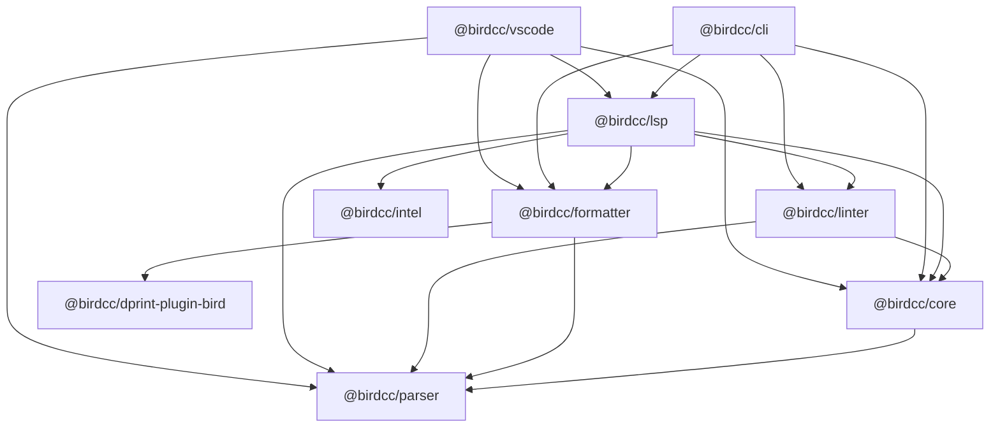

BIRD-LSP publishes eight packages to npm in the `@birdcc` scope. This page describes version 1.0.0.

Each package:

- Is an ES module (`"type": "module"`)
- Requires Node.js 22 or newer
- Uses the license GPL-3.0-only

| Package                                             | Contents                                                                                           |
| --------------------------------------------------- | -------------------------------------------------------------------------------------------------- |
| [`@birdcc/parser`](#parser)                         | Tree-sitter grammar compiled to WebAssembly, `parseBirdConfig`                                     |
| [`@birdcc/core`](#core)                             | Symbol table, type checks, cross-file `include` resolution, project configuration, entry detection |
| [`@birdcc/linter`](#linter)                         | 32 lint rules                                                                                      |
| [`@birdcc/formatter`](#formatter)                   | `dprint` and `builtin` formatting engines, safe mode                                               |
| [`@birdcc/dprint-plugin-bird`](#dprint-plugin-bird) | dprint plugin compiled from Rust to WebAssembly                                                    |
| [`@birdcc/intel`](#intel)                           | Offline ASN database                                                                               |
| [`@birdcc/lsp`](#lsp)                               | Language server                                                                                    |
| [`@birdcc/cli`](#cli)                               | The `birdcc` command: `init`, `lint`, `fmt`, `lsp`                                                 |

## Dependencies [#dependencies]

An arrow points from a package to a package that it lists in `dependencies`.



- `@birdcc/vscode` is the VS Code extension BIRD2 LSP. The project does not publish it to npm. See [VS Code extensions](#vscode).
- npm installs the `@birdcc` dependencies of a package automatically. `npm install --global @birdcc/cli` installs all eight npm packages.

## @birdcc/parser [#parser]

Parses BIRD configuration text with a Tree-sitter grammar compiled to WebAssembly and loaded through `web-tree-sitter`. The package ships the grammar as `dist/tree-sitter-birdcc.wasm`, so installation runs no native build.

```sh
npm install @birdcc/parser
```

- `parseBirdConfig(text, options?)` returns `Promise<ParsedBirdDocument>`: top-level declarations of 14 kinds and the parse issues, with 1-based source ranges. `{ includeSyntaxLayout: true }` adds the positions of brackets and comments.
- Types of the declarations, statements and results, for example `ParsedBirdDocument`, `ProtocolDeclaration`, `ParseIssue` and `SourceRange`.

```ts title="parse.mjs"
import { parseBirdConfig } from "@birdcc/parser";

const source = `
router id 192.0.2.1;

protocol bgp upstream {
  local as 65001;
  neighbor 192.0.2.2 as 65002;
  ipv4 {
    import all;
    export none;
  };
}

filter only_default {
  if net = 0.0.0.0/0 then accept;
  reject;
}
`;

const { program, issues } = await parseBirdConfig(source);

for (const declaration of program.declarations) {
  const name = "name" in declaration ? ` ${declaration.name}` : "";
  console.log(`${declaration.kind} ${declaration.line}${name}`);
}
console.log(issues.length);

const broken = await parseBirdConfig("protocol static s1 {\n  route 10.0.0.0/8 blackhole\n");
for (const issue of broken.issues) {
  console.log(`${issue.code} ${issue.line}:${issue.column} ${issue.message}`);
}
```

```text
router-id 2
protocol 4 upstream
filter 13 only_default
0
parser/syntax-error 1:1 Syntax error near 'protocol static s1 { route 10.0.0.0/8 blackhole'
syntax/unbalanced-brace 1:20 Missing '}' to close block
```

Links: [npm](https://www.npmjs.com/package/@birdcc/parser), [source and README](https://github.com/bird-chinese-community/BIRD-LSP/tree/main/packages/@birdcc/parser).

## @birdcc/core [#core]

Builds the semantic model of a configuration: the symbol table, semantic diagnostics and type-check diagnostics. The package also does these tasks:

- Resolve `include` statements across files
- Load `bird.config.json`
- Detect entry files

```sh
npm install @birdcc/core
```

- `buildCoreSnapshot(text)` and `buildCoreSnapshotFromParsed(parsed, options?)` return a `CoreSnapshot` with `symbols`, `references`, `symbolTable`, `typeDiagnostics` and `diagnostics`.
- `resolveCrossFileReferences(options)` resolves an include graph within the limits `DEFAULT_CROSS_FILE_MAX_DEPTH` (16), `DEFAULT_CROSS_FILE_MAX_FILES` (256), `DEFAULT_MAX_DOCUMENT_BYTES` (2 MiB) and `DEFAULT_MAX_TOTAL_BYTES` (16 MiB).
- `loadBirdProjectConfigForFile(path)` finds and validates the nearest `bird.config.json`. `applyLintConfiguration(diagnostics, config.linter)` applies the rule severities.
- `sniffProjectEntrypoints(root, options?)` ranks entry-file candidates for `birdcc init` and the language server.
- `parseBirdValidationOutput(output, filePath)` converts the output of `bird -p` to diagnostics.

```ts title="snapshot.mjs"
import { buildCoreSnapshot } from "@birdcc/core";

const snapshot = await buildCoreSnapshot(`
template bgp peers { local as 65001; }
protocol bgp upstream from peers { neighbor 192.0.2.2 as 65002; }
protocol bgp upstream from missing_template { neighbor 192.0.2.3 as 65003; }
`);

console.log(snapshot.symbols.map((symbol) => `${symbol.kind} ${symbol.name}`));
for (const diagnostic of snapshot.diagnostics) {
  console.log(diagnostic.severity, diagnostic.code, diagnostic.message);
}
```

```text
[ 'template peers', 'protocol upstream', 'protocol upstream' ]
error semantic/duplicate-definition protocol 'upstream' is already defined
error semantic/undefined-reference Undefined template reference 'missing_template'
```

The linter reports these core diagnostics under rule codes. [Rules](./rules.mdx#parser-and-core) lists the mapping.

Links: [npm](https://www.npmjs.com/package/@birdcc/core), [source and README](https://github.com/bird-chinese-community/BIRD-LSP/tree/main/packages/@birdcc/core).

## @birdcc/linter [#linter]

Checks a configuration against the 32 rules of the groups `sym`, `cfg`, `net`, `type`, `bgp` and `ospf`. The rule set is fixed; the package has no API to add rules.

```sh
npm install @birdcc/linter
```

- `lintBirdConfig(text, options?)` returns `Promise<LintResult>` with `parsed`, `core` and `diagnostics`. `uri` sets the URI of the document. Pass `parsed` or `core` to reuse earlier results.
- `lintResolvedCrossFileGraph(resolution)` lints every file of a result of `resolveCrossFileReferences` with the merged symbol table and returns `{ diagnostics, byUri }`.

```ts title="lint.mjs"
import { lintBirdConfig } from "@birdcc/linter";

const source = `
router id 192.0.2.1;

protocol bgp upstream {
  neighbor 192.0.2.2 as 65002;
  ipv4 { import filter missing_filter; };
}
`;

const result = await lintBirdConfig(source, {
  uri: "file:///etc/bird/bird.conf",
});
for (const diagnostic of result.diagnostics) {
  const { line, column } = diagnostic.range;
  console.log(`${diagnostic.severity} ${diagnostic.code} ${line}:${column} ${diagnostic.message}`);
}
```

```text
warning sym/filter-required 6:24 Protocol 'upstream' references unknown filter 'missing_filter'
info bgp/missing-local-as 4:14 BGP protocol 'upstream' missing local AS number
```

`lintBirdConfig` does not read `bird.config.json`. To apply `linter.rules`, pass the diagnostics to `applyLintConfiguration` of `@birdcc/core`.

[Rules](./rules.mdx) describes every rule. Links: [npm](https://www.npmjs.com/package/@birdcc/linter), [source and README](https://github.com/bird-chinese-community/BIRD-LSP/tree/main/packages/@birdcc/linter).

## @birdcc/formatter [#formatter]

Formats BIRD configuration text with the `dprint` engine (default) or the `builtin` engine, with safe mode on by default.

```sh
npm install @birdcc/formatter
```

- `formatBirdConfig(text, options?)` returns `Promise<BirdFormatResult>`: `{ text, changed, engine }`. `engine` names the engine that produced the text.
- `checkBirdConfigFormat(text, options?)` returns `{ changed }`.
- The options are `engine`, `indentSize`, `useTabs`, `lineWidth` and `safeMode`, with the defaults in [Formatter options](../formatting.mdx#options).

```ts title="format.mjs"
import { checkBirdConfigFormat, formatBirdConfig } from "@birdcc/formatter";

const source = `protocol bgp upstream {
local as 65001;
    neighbor 192.0.2.2 as 65002;   # transit


ipv4 {
import all;
export where net ~ [ 10.0.0.0/8+ ];
};
}
`;

const result = await formatBirdConfig(source);
console.log(result.engine, result.changed);
console.log(result.text);

const { changed } = await checkBirdConfigFormat(result.text);
console.log(changed);
```

```text
dprint true
protocol bgp upstream {
  local as 65001;
  neighbor 192.0.2.2 as 65002; # transit

  ipv4 {
    import all;
    export where net ~ [ 10.0.0.0/8+ ];
  };
}

false
```

When the `dprint` engine fails:

- Without `engine` in the options, `formatBirdConfig` formats the text again with `builtin`.
- With `engine: "dprint"`, `formatBirdConfig` throws.

[Format configurations](../formatting.mdx) describes the rules, the engines and safe mode. Links: [npm](https://www.npmjs.com/package/@birdcc/formatter), [source and README](https://github.com/bird-chinese-community/BIRD-LSP/tree/main/packages/@birdcc/formatter).

## @birdcc/dprint-plugin-bird [#dprint-plugin-bird]

The dprint plugin for BIRD configuration files, a Rust crate compiled for `wasm32-unknown-unknown`. The package ships the module as `dist/dprint-plugin-bird.wasm`. `@birdcc/formatter` uses it for the `dprint` engine, and the dprint CLI loads it as a plugin.

```sh
npm install @birdcc/dprint-plugin-bird @dprint/formatter
```

- `getPath()` returns the absolute path of `dist/dprint-plugin-bird.wasm`.
- `getBuffer()` reads the module and returns it as a `Uint8Array`, on each call.

The example runs the plugin in `@dprint/formatter`, which is a separate package:

```ts title="dprint.mjs"
import { createContext } from "@dprint/formatter";
import { getBuffer } from "@birdcc/dprint-plugin-bird";

const context = createContext({ lineWidth: 80, indentWidth: 2 });
context.addPlugin(getBuffer(), { safeMode: true });

const output = context.formatText({
  filePath: "bird.conf",
  fileText: "protocol device {\nscan time 10;\n}\n",
});
process.stdout.write(output);
```

```text
protocol device {
  scan time 10;
}
```

`formatText` throws when safe mode rejects the output or when no plugin handles the file extension.

[Use the dprint plugin](../formatting.mdx#dprint) shows the configuration for the dprint CLI. Links: [npm](https://www.npmjs.com/package/@birdcc/dprint-plugin-bird), [source and README](https://github.com/bird-chinese-community/BIRD-LSP/tree/main/packages/@birdcc/dprint-plugin-bird).

## @birdcc/intel [#intel]

Contains `db/asn-db.bin.gz`, an offline snapshot of AS names, classes and country codes from BGP.Tools-OpenDB, and lookup functions for it. The language server uses it for ASN completion, hover and inlay hints.

```sh
npm install @birdcc/intel
```

- `createAsnIntel(dbPath?)` loads the bundled database or the file at `dbPath` and returns an `AsnIntel` object with `available`, `count`, `exactLookup(asn)`, `prefixSearch(prefix, limit?)`, `lookupDisplay(asn)` and `formatDisplay(entry)`. When `createAsnIntel` cannot load the file, it returns `available: false` and a `failure` object and does not throw.
- `loadAsnDatabase(options)` loads a database file and throws on errors.
- `formatAsnDisplay(entry)` and `countryCodeToFlag(cc)` build the text of hover, completion and inlay hints.

```ts title="asn.mjs"
import { createAsnIntel } from "@birdcc/intel";

const intel = createAsnIntel();
if (!intel.available) {
  throw new Error(`ASN database unavailable: ${intel.failure?.code}`);
}

console.log(intel.exactLookup(13335));
console.log(intel.prefixSearch("1333", 3).map((entry) => entry.asn));
console.log(intel.exactLookup(65001));
```

```text
{ asn: 13335, name: 'Cloudflare, Inc.', cls: 'Content', cc: 'US' }
[ 1333, 13330, 133300 ]
{ asn: 65001, name: 'RFC 6996', cls: 'Reserved', cc: 'ZZ' }
```

The results depend on the database snapshot in the installed version.

[ASN data](../asn-data.mdx) describes the data and its updates. Links: [npm](https://www.npmjs.com/package/@birdcc/intel), [source and README](https://github.com/bird-chinese-community/BIRD-LSP/tree/main/packages/@birdcc/intel).

## @birdcc/lsp [#lsp]

The language server. It communicates over stdio with `vscode-languageserver` and uses `@birdcc/core`, `@birdcc/linter`, `@birdcc/formatter` and `@birdcc/intel`.

```sh
npm install @birdcc/lsp
```

- `startLspServer(options?)` starts the server. `asnDbPath` loads another ASN database file, and `disableAsnIntel: true` turns off the ASN features.
- `toLspDiagnostic(diagnostic)` converts a `BirdDiagnostic` with 1-based positions to an LSP `Diagnostic` with 0-based positions.
- Functions for completion, hover, definitions, references, document symbols and ASN features, for example `createCompletionItemsFromParsed` and `createAsnHover`.

```ts title="server.mjs"
import { startLspServer } from "@birdcc/lsp";

startLspServer({ disableAsnIntel: true });
```

```sh
node server.mjs --stdio
```

`vscode-languageserver` reads the transport from the process arguments. Without a script, run `birdcc lsp --stdio` or `node node_modules/@birdcc/lsp/dist/server.js --stdio`.

[Language server](./language-server.mdx) lists the capabilities and settings. Links: [npm](https://www.npmjs.com/package/@birdcc/lsp), [source and README](https://github.com/bird-chinese-community/BIRD-LSP/tree/main/packages/@birdcc/lsp).

## @birdcc/cli [#cli]

The `birdcc` command, and the functions behind it for use in scripts.

```sh
npm install --global @birdcc/cli
```

- The `birdcc` command with `lint`, `fmt`, `init` and `lsp`. See the [CLI reference](./cli.mdx).
- `runLint(filePath, options?)` lints a file and returns `{ diagnostics }`. `runFmt(filePath, options?)` formats a file and returns `{ changed, formattedText }`; it writes the file when `write` is `true`.
- `runBirdValidation`, `parseBirdStderr`, `formatBirdConfigText` and `runLspStdio`.
- The subpath `@birdcc/cli/output-types` exports the TypeScript types of the JSON output, and `@birdcc/cli/output-schemas` exports zod 4 schemas of it, for example `BirdLintJsonOutputSchema`.

The functions do not read `bird.config.json`. Pass the options in the call.

To call the functions from a project, install the package locally with `npm install @birdcc/cli`:

```ts title="check.mjs"
import { runFmt, runLint } from "@birdcc/cli";

const { diagnostics } = await runLint("bird.conf", {
  severityOverrides: { "sym/*": "error" },
});
for (const diagnostic of diagnostics) {
  console.log(diagnostic.severity, diagnostic.code, diagnostic.range.line, diagnostic.message);
}

const { changed } = await runFmt("bird.conf", { indentSize: 4 });
console.log(changed ? "needs formatting" : "already formatted");
```

For a `bird.conf` with an unindented line and an import filter `peer_in` that no file defines, the output is:

```text
error sym/filter-required 6 Protocol 'upstream' references unknown filter 'peer_in'
needs formatting
```

Links: [npm](https://www.npmjs.com/package/@birdcc/cli), [source and README](https://github.com/bird-chinese-community/BIRD-LSP/tree/main/packages/@birdcc/cli).

## VS Code extensions [#vscode]

The repository publishes two packages as VS Code extensions to the VS Code Marketplace and Open VSX, not to npm:

| Package                | Extension ID                  | Contents                                                                               |
| ---------------------- | ----------------------------- | -------------------------------------------------------------------------------------- |
| `@birdcc/vscode`       | `BIRDCC.bird2-lsp`            | BIRD2 LSP: the language server, formatting, snippets and `bird -p` fallback validation |
| `bird2-extension-pack` | `BIRDCC.bird2-extension-pack` | BIRD2 Extension Pack: `BIRDCC.bird2-lsp` and `BIRDCC.vscode-bird2-conf`                |

[VS Code](../editors/vscode.mdx) describes the installation and the settings.
