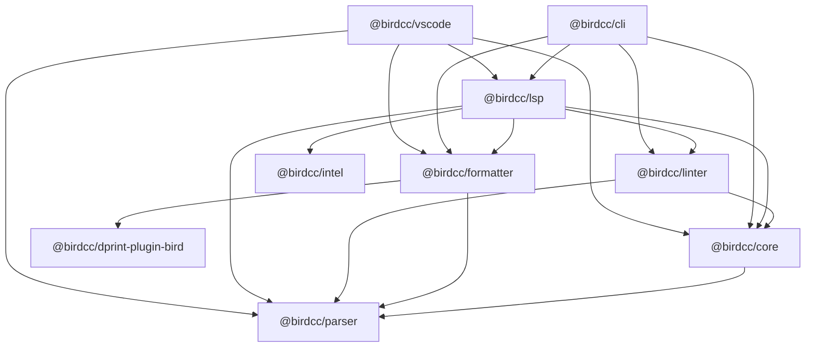

BIRD-LSP 在 `@birdcc` scope 下向 npm 发布八个包。本页对应 1.0.0 版本。

每个包都符合以下各项：

- 是 ES module (`"type": "module"`)
- 需要 Node.js 22 或更新版本
- 许可证为 GPL-3.0-only

| 包                                                  | 内容                                                                                                                                  |
| --------------------------------------------------- | ------------------------------------------------------------------------------------------------------------------------------------- |
| [`@birdcc/parser`](#parser)                         | 编译为 WebAssembly 的 Tree-sitter 语法 (grammar)，`parseBirdConfig`                                                                   |
| [`@birdcc/core`](#core)                             | 符号表 (symbol table)、类型检查 (type check)、跨文件 `include` 解析、项目配置 (project configuration)、入口文件探测 (entry detection) |
| [`@birdcc/linter`](#linter)                         | 32 条 lint 规则                                                                                                                       |
| [`@birdcc/formatter`](#formatter)                   | `dprint` 与 `builtin` 两个格式化引擎 (formatting engine)，安全模式 (safe mode)                                                        |
| [`@birdcc/dprint-plugin-bird`](#dprint-plugin-bird) | 由 Rust 编译为 WebAssembly 的 dprint 插件                                                                                             |
| [`@birdcc/intel`](#intel)                           | 离线 ASN 数据库 (ASN database)                                                                                                        |
| [`@birdcc/lsp`](#lsp)                               | 语言服务器 (language server)                                                                                                          |
| [`@birdcc/cli`](#cli)                               | `birdcc` 命令：`init`、`lint`、`fmt`、`lsp`                                                                                           |

## 依赖关系 [#dependencies]

箭头从一个包指向它在 `dependencies` 中列出的包。



- `@birdcc/vscode` 是 VS Code 扩展 (extension) BIRD2 LSP，项目不把它发布到 npm。见 [VS Code 扩展](#vscode)。
- npm 会自动安装一个包所依赖的 `@birdcc` 包。`npm install --global @birdcc/cli` 会装上全部八个 npm 包。

## 解析器 (`@birdcc/parser`) [#parser]

用编译为 WebAssembly 的 Tree-sitter 语法解析 BIRD 配置文本，语法通过 `web-tree-sitter` 加载。包内附带语法文件 `dist/tree-sitter-birdcc.wasm`，安装时不需要本地编译。

```sh
npm install @birdcc/parser
```

- `parseBirdConfig(text, options?)` 返回 `Promise<ParsedBirdDocument>`：14 种顶层声明和解析问题 (parse issue)，源码范围 (source range) 从 1 开始计数。传入 `{ includeSyntaxLayout: true }` 时，结果还包含括号与注释的位置。
- 声明、语句和结果的类型，例如 `ParsedBirdDocument`、`ProtocolDeclaration`、`ParseIssue` 和 `SourceRange`。

```ts title="parse.mjs"
import { parseBirdConfig } from "@birdcc/parser";

const source = `
router id 192.0.2.1;

protocol bgp upstream {
  local as 65001;
  neighbor 192.0.2.2 as 65002;
  ipv4 {
    import all;
    export none;
  };
}

filter only_default {
  if net = 0.0.0.0/0 then accept;
  reject;
}
`;

const { program, issues } = await parseBirdConfig(source);

for (const declaration of program.declarations) {
  const name = "name" in declaration ? ` ${declaration.name}` : "";
  console.log(`${declaration.kind} ${declaration.line}${name}`);
}
console.log(issues.length);

const broken = await parseBirdConfig("protocol static s1 {\n  route 10.0.0.0/8 blackhole\n");
for (const issue of broken.issues) {
  console.log(`${issue.code} ${issue.line}:${issue.column} ${issue.message}`);
}
```

```text
router-id 2
protocol 4 upstream
filter 13 only_default
0
parser/syntax-error 1:1 Syntax error near 'protocol static s1 { route 10.0.0.0/8 blackhole'
syntax/unbalanced-brace 1:20 Missing '}' to close block
```

链接：[npm](https://www.npmjs.com/package/@birdcc/parser)、[源码与 README](https://github.com/bird-chinese-community/BIRD-LSP/tree/main/packages/@birdcc/parser)。

## 语义分析核心 (`@birdcc/core`) [#core]

构建配置的语义模型 (semantic model)：符号表、语义诊断 (semantic diagnostic) 和类型检查诊断。这个包还完成以下工作：

- 跨文件解析 `include` 语句
- 加载 `bird.config.json`
- 探测入口文件 (entry file)

```sh
npm install @birdcc/core
```

- `buildCoreSnapshot(text)` 与 `buildCoreSnapshotFromParsed(parsed, options?)` 返回 `CoreSnapshot`，其中包含 `symbols`、`references`、`symbolTable`、`typeDiagnostics` 和 `diagnostics`。
- `resolveCrossFileReferences(options)` 在以下上限内解析 include 图 (include graph)：`DEFAULT_CROSS_FILE_MAX_DEPTH` (16)、`DEFAULT_CROSS_FILE_MAX_FILES` (256)、`DEFAULT_MAX_DOCUMENT_BYTES` (2 MiB) 和 `DEFAULT_MAX_TOTAL_BYTES` (16 MiB)。
- `loadBirdProjectConfigForFile(path)` 查找并校验最近的 `bird.config.json`。`applyLintConfiguration(diagnostics, config.linter)` 应用规则级别 (severity) 设置。
- `sniffProjectEntrypoints(root, options?)` 为 `birdcc init` 和语言服务器对入口文件候选排序。
- `parseBirdValidationOutput(output, filePath)` 把 `bird -p` 的输出转换为诊断。

```ts title="snapshot.mjs"
import { buildCoreSnapshot } from "@birdcc/core";

const snapshot = await buildCoreSnapshot(`
template bgp peers { local as 65001; }
protocol bgp upstream from peers { neighbor 192.0.2.2 as 65002; }
protocol bgp upstream from missing_template { neighbor 192.0.2.3 as 65003; }
`);

console.log(snapshot.symbols.map((symbol) => `${symbol.kind} ${symbol.name}`));
for (const diagnostic of snapshot.diagnostics) {
  console.log(diagnostic.severity, diagnostic.code, diagnostic.message);
}
```

```text
[ 'template peers', 'protocol upstream', 'protocol upstream' ]
error semantic/duplicate-definition protocol 'upstream' is already defined
error semantic/undefined-reference Undefined template reference 'missing_template'
```

Linter 用规则代码 (rule code) 报告这些 core 诊断，对应关系见[规则](./rules.mdx#parser-and-core)。

链接：[npm](https://www.npmjs.com/package/@birdcc/core)、[源码与 README](https://github.com/bird-chinese-community/BIRD-LSP/tree/main/packages/@birdcc/core)。

## Lint 引擎 (`@birdcc/linter`) [#linter]

用 `sym`、`cfg`、`net`、`type`、`bgp`、`ospf` 六组共 32 条规则检查配置。规则集是固定的，包中没有添加规则的 API。

```sh
npm install @birdcc/linter
```

- `lintBirdConfig(text, options?)` 返回 `Promise<LintResult>`，其中包含 `parsed`、`core` 和 `diagnostics`。`uri` 设置文档的 URI。传入 `parsed` 或 `core` 可复用之前的结果。
- `lintResolvedCrossFileGraph(resolution)` 用合并后的符号表检查 `resolveCrossFileReferences` 结果中的每个文件，返回 `{ diagnostics, byUri }`。

```ts title="lint.mjs"
import { lintBirdConfig } from "@birdcc/linter";

const source = `
router id 192.0.2.1;

protocol bgp upstream {
  neighbor 192.0.2.2 as 65002;
  ipv4 { import filter missing_filter; };
}
`;

const result = await lintBirdConfig(source, {
  uri: "file:///etc/bird/bird.conf",
});
for (const diagnostic of result.diagnostics) {
  const { line, column } = diagnostic.range;
  console.log(`${diagnostic.severity} ${diagnostic.code} ${line}:${column} ${diagnostic.message}`);
}
```

```text
warning sym/filter-required 6:24 Protocol 'upstream' references unknown filter 'missing_filter'
info bgp/missing-local-as 4:14 BGP protocol 'upstream' missing local AS number
```

`lintBirdConfig` 不读取 `bird.config.json`。要应用 `linter.rules`，把诊断传给 `@birdcc/core` 的 `applyLintConfiguration`。

[规则](./rules.mdx)介绍每条规则。链接：[npm](https://www.npmjs.com/package/@birdcc/linter)、[源码与 README](https://github.com/bird-chinese-community/BIRD-LSP/tree/main/packages/@birdcc/linter)。

## 格式化器 (`@birdcc/formatter`) [#formatter]

用 `dprint` 引擎（默认）或 `builtin` 引擎格式化 BIRD 配置文本，安全模式默认开启。

```sh
npm install @birdcc/formatter
```

- `formatBirdConfig(text, options?)` 返回 `Promise<BirdFormatResult>`：`{ text, changed, engine }`。`engine` 是实际产生文本的引擎。
- `checkBirdConfigFormat(text, options?)` 返回 `{ changed }`。
- 选项有 `engine`、`indentSize`、`useTabs`、`lineWidth` 和 `safeMode`，默认值见[格式化选项](../formatting.mdx#options)。

```ts title="format.mjs"
import { checkBirdConfigFormat, formatBirdConfig } from "@birdcc/formatter";

const source = `protocol bgp upstream {
local as 65001;
    neighbor 192.0.2.2 as 65002;   # transit


ipv4 {
import all;
export where net ~ [ 10.0.0.0/8+ ];
};
}
`;

const result = await formatBirdConfig(source);
console.log(result.engine, result.changed);
console.log(result.text);

const { changed } = await checkBirdConfigFormat(result.text);
console.log(changed);
```

```text
dprint true
protocol bgp upstream {
  local as 65001;
  neighbor 192.0.2.2 as 65002; # transit

  ipv4 {
    import all;
    export where net ~ [ 10.0.0.0/8+ ];
  };
}

false
```

`dprint` 引擎失败时：

- 选项中没有 `engine`：`formatBirdConfig` 改用 `builtin` 重新格式化。
- 选项为 `engine: "dprint"`：`formatBirdConfig` 抛出错误。

[格式化配置](../formatting.mdx)介绍格式化规则、引擎和安全模式。链接：[npm](https://www.npmjs.com/package/@birdcc/formatter)、[源码与 README](https://github.com/bird-chinese-community/BIRD-LSP/tree/main/packages/@birdcc/formatter)。

## dprint 插件 (`@birdcc/dprint-plugin-bird`) [#dprint-plugin-bird]

BIRD 配置文件的 dprint 插件，是一个编译为 `wasm32-unknown-unknown` 的 Rust crate。包内附带模块文件 `dist/dprint-plugin-bird.wasm`。`@birdcc/formatter` 的 `dprint` 引擎使用它，dprint CLI 也可以把它作为插件加载。

```sh
npm install @birdcc/dprint-plugin-bird @dprint/formatter
```

- `getPath()` 返回 `dist/dprint-plugin-bird.wasm` 的绝对路径。
- `getBuffer()` 每次调用都读取模块文件，以 `Uint8Array` 返回。

示例在 `@dprint/formatter` 中运行插件，`@dprint/formatter` 是另一个独立的包：

```ts title="dprint.mjs"
import { createContext } from "@dprint/formatter";
import { getBuffer } from "@birdcc/dprint-plugin-bird";

const context = createContext({ lineWidth: 80, indentWidth: 2 });
context.addPlugin(getBuffer(), { safeMode: true });

const output = context.formatText({
  filePath: "bird.conf",
  fileText: "protocol device {\nscan time 10;\n}\n",
});
process.stdout.write(output);
```

```text
protocol device {
  scan time 10;
}
```

安全模式拒绝输出，或者没有插件处理该文件扩展名时，`formatText` 抛出错误。

dprint CLI 的配置见[使用 dprint 插件](../formatting.mdx#dprint)。链接：[npm](https://www.npmjs.com/package/@birdcc/dprint-plugin-bird)、[源码与 README](https://github.com/bird-chinese-community/BIRD-LSP/tree/main/packages/@birdcc/dprint-plugin-bird)。

## ASN 数据 (`@birdcc/intel`) [#intel]

包含 `db/asn-db.bin.gz`（来自 BGP.Tools-OpenDB 的 AS 名称、类别和国家代码的离线快照）以及查询它的函数。语言服务器用它提供 ASN 补全 (completion)、悬停提示 (hover) 和内嵌提示 (inlay hint)。

```sh
npm install @birdcc/intel
```

- `createAsnIntel(dbPath?)` 加载自带的数据库或 `dbPath` 指定的文件，返回 `AsnIntel` 对象，其中包含 `available`、`count`、`exactLookup(asn)`、`prefixSearch(prefix, limit?)`、`lookupDisplay(asn)` 和 `formatDisplay(entry)`。`createAsnIntel` 无法加载文件时返回 `available: false` 和一个 `failure` 对象，不抛出错误。
- `loadAsnDatabase(options)` 加载数据库文件，出错时抛出错误。
- `formatAsnDisplay(entry)` 与 `countryCodeToFlag(cc)` 生成悬停提示、补全和内嵌提示中显示的文本。

```ts title="asn.mjs"
import { createAsnIntel } from "@birdcc/intel";

const intel = createAsnIntel();
if (!intel.available) {
  throw new Error(`ASN database unavailable: ${intel.failure?.code}`);
}

console.log(intel.exactLookup(13335));
console.log(intel.prefixSearch("1333", 3).map((entry) => entry.asn));
console.log(intel.exactLookup(65001));
```

```text
{ asn: 13335, name: 'Cloudflare, Inc.', cls: 'Content', cc: 'US' }
[ 1333, 13330, 133300 ]
{ asn: 65001, name: 'RFC 6996', cls: 'Reserved', cc: 'ZZ' }
```

结果取决于所安装版本中的数据库快照。

[ASN 数据](../asn-data.mdx)介绍数据及其更新方式。链接：[npm](https://www.npmjs.com/package/@birdcc/intel)、[源码与 README](https://github.com/bird-chinese-community/BIRD-LSP/tree/main/packages/@birdcc/intel)。

## 语言服务器 (`@birdcc/lsp`) [#lsp]

语言服务器。它通过 `vscode-languageserver` 在 stdio 上通信，并使用 `@birdcc/core`、`@birdcc/linter`、`@birdcc/formatter` 和 `@birdcc/intel`。

```sh
npm install @birdcc/lsp
```

- `startLspServer(options?)` 启动服务器。`asnDbPath` 加载另一个 ASN 数据库文件，`disableAsnIntel: true` 关闭 ASN 功能。
- `toLspDiagnostic(diagnostic)` 把位置从 1 开始计数的 `BirdDiagnostic` 转换为位置从 0 开始计数的 LSP `Diagnostic`。
- 补全、悬停提示、定义 (definition)、引用 (reference)、文档符号 (document symbol) 和 ASN 功能的函数，例如 `createCompletionItemsFromParsed` 与 `createAsnHover`。

```ts title="server.mjs"
import { startLspServer } from "@birdcc/lsp";

startLspServer({ disableAsnIntel: true });
```

```sh
node server.mjs --stdio
```

`vscode-languageserver` 从进程参数读取传输方式。不写脚本时，运行 `birdcc lsp --stdio` 或 `node node_modules/@birdcc/lsp/dist/server.js --stdio`。

[语言服务器](./language-server.mdx)列出服务器的能力和设置。链接：[npm](https://www.npmjs.com/package/@birdcc/lsp)、[源码与 README](https://github.com/bird-chinese-community/BIRD-LSP/tree/main/packages/@birdcc/lsp)。

## 命令行工具 (`@birdcc/cli`) [#cli]

`birdcc` 命令，以及它背后可在脚本中调用的函数。

```sh
npm install --global @birdcc/cli
```

- `birdcc` 命令，包含 `lint`、`fmt`、`init` 和 `lsp`。见 [CLI 参考](./cli.mdx)。
- `runLint(filePath, options?)` 检查一个文件，返回 `{ diagnostics }`。`runFmt(filePath, options?)` 格式化一个文件，返回 `{ changed, formattedText }`；`write` 为 `true` 时写入文件。
- `runBirdValidation`、`parseBirdStderr`、`formatBirdConfigText` 和 `runLspStdio`。
- 子路径 `@birdcc/cli/output-types` 导出 JSON 输出的 TypeScript 类型，`@birdcc/cli/output-schemas` 导出 JSON 输出的 zod 4 schema，例如 `BirdLintJsonOutputSchema`。

这些函数不读取 `bird.config.json`，选项需要在调用时传入。

在项目中调用这些函数时，用 `npm install @birdcc/cli` 在本地安装这个包：

```ts title="check.mjs"
import { runFmt, runLint } from "@birdcc/cli";

const { diagnostics } = await runLint("bird.conf", {
  severityOverrides: { "sym/*": "error" },
});
for (const diagnostic of diagnostics) {
  console.log(diagnostic.severity, diagnostic.code, diagnostic.range.line, diagnostic.message);
}

const { changed } = await runFmt("bird.conf", { indentSize: 4 });
console.log(changed ? "needs formatting" : "already formatted");
```

`bird.conf` 中有一行没有缩进，并且引用了没有任何文件定义的导入过滤器 `peer_in` 时，输出为：

```text
error sym/filter-required 6 Protocol 'upstream' references unknown filter 'peer_in'
needs formatting
```

链接：[npm](https://www.npmjs.com/package/@birdcc/cli)、[源码与 README](https://github.com/bird-chinese-community/BIRD-LSP/tree/main/packages/@birdcc/cli)。

## VS Code 扩展 [#vscode]

仓库把两个包作为 VS Code 扩展发布到 VS Code Marketplace 和 Open VSX，不发布到 npm：

| 包                     | 扩展 ID                       | 内容                                                                                          |
| ---------------------- | ----------------------------- | --------------------------------------------------------------------------------------------- |
| `@birdcc/vscode`       | `BIRDCC.bird2-lsp`            | BIRD2 LSP：语言服务器、格式化、代码片段 (snippet) 和 `bird -p` 回退校验 (fallback validation) |
| `bird2-extension-pack` | `BIRDCC.bird2-extension-pack` | BIRD2 Extension Pack：`BIRDCC.bird2-lsp` 与 `BIRDCC.vscode-bird2-conf`                        |

[VS Code](../editors/vscode.mdx) 介绍安装方法和设置项。
